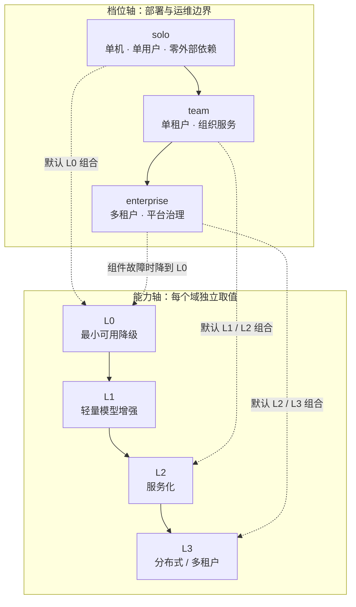
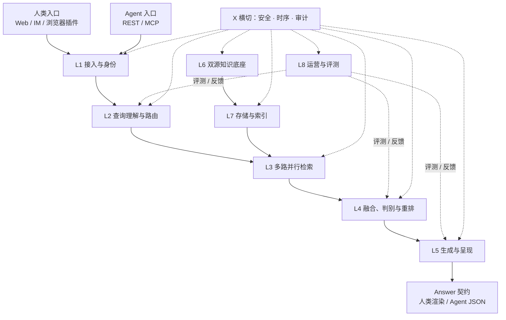
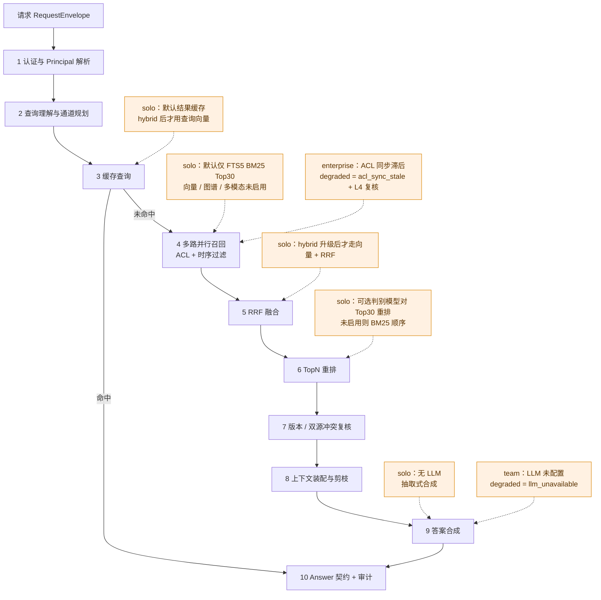
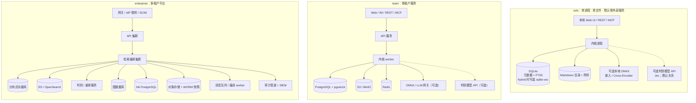

# 分层 AI 知识库架构（v2）

> 状态：设计基线；Rust 实现已落地，待构建验证（P1）
> 基线：企业 AI 知识库 v1 架构图（8 层 + X 横切）
> 配套矩阵：[tier-matrix.md](tier-matrix.md)
> 范围：逻辑架构、层间契约、数据模型、请求链路、部署拓扑与迁移路径。产品使用文档不在本文件范围内。

## 1. 定位与 v1→v2 变更摘要

### 1.1 定位

本系统是一个可分层部署的知识检索与回答内核：同一套领域模型、检索流程、治理规则与 Answer（回答）契约，在 solo / team / enterprise 三个档位（profile）上运行。档位改变的是适配器、默认能力等级、身份边界与运维形态，不改变内核行为。

目标不是把企业版裁剪成个人版，也不是维护两套代码。个人档位产生的每一份文档、每一个 ID、每一组治理字段，都必须能原样进入团队与企业档位；企业档位新增的治理能力，必须能在个人档位以 allow-all（全放行）策略和固定默认值存在，而不是缺席。

### 1.2 为什么改

v1 是一份成立的企业单档架构，但存在四个无法回避的落地问题：

1. **默认部署假设过重。** v1 默认外部向量库、图数据库、对象存储、缓存与 LLM。个人用户为了问一个本地目录的问题，需要先承担一套企业基础设施的安装与运维成本。
2. **没有定义组件缺失时的行为。** v1 描述了多路通道，但没有规定某一路超时、模型缺失或存储不可用时，响应应该长什么样。结果是实现层各自静默回退，用户无法判断答案缺了什么。
3. **治理是原则，不是 schema 强制项。** v1 把权限、时序、租户隔离列为横切约束，但没有把 `tenant_id`、`space_id`、`ACL`、`valid_from`、`valid_to`、`version`、`superseded_by` 定义为所有实体第一天就必填的字段。后补这些字段意味着全量重建索引、回填无法推断的历史 ACL，并承担一次真实的数据泄漏风险。
4. **没有规模边界。** v1 没有说明精确检索能撑到多少切片、何时必须引入近似最近邻（Approximate Nearest Neighbor, ANN）、何时必须从单机切到分布式。没有阈值，升级判断只能靠感觉。

v2 保留 v1 的分层与关键取舍，增加“档位 × 能力等级”两个维度，并把“缺组件时怎么办”从实现细节提升为响应契约。

### 1.3 改了什么

| 维度 | v1 | v2 | 变更理由 |
| --- | --- | --- | --- |
| 服务对象 | 企业单档 | solo / team / enterprise 三档 | 个人可用性与企业可治理性必须同时成立，且共享内核 |
| 依赖形态 | 默认外部向量库、图库、对象存储、缓存、LLM | 按档位收敛；solo 默认零外部依赖 | 降低个人启动成本，同时不牺牲企业能力 |
| 能力配置 | 固定一套实现 | 每个能力域独立取 L0–L3；档位给默认值 | 同一档位内硬件、预算、数据域差异大；组件也会故障 |
| 候选判别 | 通用打分模型 / LLM 择优 | 引入决策/判别模型（decision model）做证据判断与重排；不替代生成 | 只对已召回候选生效，提升“召回到了但没排上去”的精度；按输入 token 计费、输出免费，适合放在生成前 |
| 多跳通道 | 仅 BM25 + 可选 judge | 可选 event-entity SQL-RAG；clean-room 实现，默认关闭 | 改进共享实体多跳召回；不维护全局图，抽取失败不阻塞 BM25 |
| 治理字段 | 原则内建 | `tenant_id` / `space_id` / `ACL` / 时序 / 版本 day-one 必填 | 后补需要全量重建，且无法可靠回填历史权限 |
| 双源 | 强制双源 | solo 可选，team 建议，enterprise 对外部文件强制；内置 Wiki 原生页面以不可变 Revision 为源 A | 个人场景重复维护成本高于收益；企业场景必须可核对，但不为原生页面虚构第二份原件 |
| 降级 | 未定义 | `degraded[]` 契约 + 稳定码表 + 分类与优先级 | 禁止静默回退，保证人类与 Agent 都能判断证据缺口 |
| 输出契约 | 人类/Agent 两套描述 | 单一 Answer 契约，REST 与 MCP 共用同一检索内核 | 避免 Agent 走一条未经人类路径测试的旁路 |
| 文档身份 | 未定义 | `doc_id` 由内容指纹与逻辑路径派生；同路径同内容跨档稳定，内容变化生成新 ID 并保留旧 ID | 引用、书签、审计与 Agent 缓存可回跳；内容版本演进不被静默覆盖 |
| 规模 | 未定义 | 每档文档量、切片量、并发量与升级信号 | 让“何时换架构”成为可观测的决策，而不是事后救火 |

### 1.4 没有改的部分

以下 v1 结论在 v2 中继续成立，只按档位选择实现方式：

- L1–L8 与 X 横切的职责边界与编号。
- 权限必须在召回阶段过滤，结果层过滤不能作为主路径。
- 多路结果使用倒数排名融合（Reciprocal Rank Fusion, RRF），不直接比较不同通道的原始分数。
- 打分与重排只发生在候选集之上，且只对 TopN 候选执行；有融合时在融合之后，没有融合时直接对召回 TopN 执行。成本不随全量候选线性增长。
- 双源可核对：转写层负责可检索，原件层负责可验证、可追责。
- 评测集回归：任何分块、嵌入、检索或重排变更都必须跑同一套基线。
- 人类与 Agent 共用检索内核；Agent 需要结构化结果，而不是另一套检索逻辑。

## 2. 分层模型：档位 × 能力等级

### 2.1 两个维度

**档位（profile）** 是部署与运维边界，回答四个问题：谁部署、服务多少主体、身份从哪里来、故障时由谁负责。档位取值固定为 `solo`、`team`、`enterprise`。

**能力等级（capability level）** 是某个能力域的实现深度。五个必须独立配置的能力域是：检索通道、重排、治理、多模态、规模；生成、评测与审计作为支撑域同样分级。每个域取 `L0`–`L3`：

- `L0`：最小可用降级实现。它是真实实现，不是空壳或关闭开关。
- `L1`：轻量增强，引入本地模型、本地辅助索引，或单路判别模型（可远程）。
- `L2`：服务化，依赖外部存储或模型服务，单租户。
- `L3`：分布式、多租户、全量多模态与合规审计。

### 2.2 二维模型

二维模型不是营销分层。档位决定默认值与物理上限，能力等级决定当前实际执行路径。两者可以不同步：solo 可以开启本地 Cross-Encoder 进入重排 L1；enterprise 也可以因为图数据库故障暂时退到图谱 L0。

### 2.3 默认能力向量

| 能力域 | solo 默认 | team 默认 | enterprise 默认 |
| --- | --- | --- | --- |
| 检索通道 | L0：FTS5 BM25 Top 30 + SQL 点查；向量与 event_entity 默认关闭，分别按 hybrid / 抽取配置启用 | L2：关键词 + 向量 hybrid，RRF 融合；event_entity 可选 | L3：分布式多路并行；event_entity 按租户/空间可选 |
| 重排 | L0：BM25 顺序 + 规则；可选判别模型对 Top 30 重排 | L2：RRF + Cross-Encoder；可选判别模型 | L3：RRF + 判别模型 + Cross-Encoder + 可选 LLM 择优 |
| 治理 | L0：单租户 allow-all 策略对象 | L2：OIDC + 组 ACL | L3：多租户 + 源 ACL 同步 + 策略引擎 |
| 多模态 | L0：文本层与可抽取文本 | L1：OCR / 图片图注可选 | L3：OCR + ASR + VLM + 视频关键帧 |
| 规模 | L0：单进程，≤ 3 万切片 | L2：单租户集群，≤ 200 万切片 | L3：分布式，平台 ≤ 2 亿切片 |
| 生成 | L0：抽取式 + 模板 | L2：LLM 可选 | L3：LLM + 忠实度校验 |
| 评测 / 审计 | L0：本地固定集 + 本地日志 | L2：CI 回归 + 集中日志 | L3：持续评测 + 不可篡改审计 |

逐项实现、降级形态与触发条件见 [tier-matrix.md](tier-matrix.md)。本表只固定默认组合，不展开实现细节。

### 2.4 正交性的边界

“正交”指能力等级不因档位自动继承，不指所有组合都合法。合法组合在启动时校验；非法组合直接拒绝启动，而不是运行时静默降级。

| 组合 | 是否允许 | 处理 |
| --- | --- | --- |
| solo + 规模 L3 | 否 | 单进程无法提供分布式分片与多租户隔离，启动校验失败 |
| team + 治理 L3 | 否 | 多租户隔离需要 enterprise 档位；team 只能到治理 L2 |
| solo + 重排 L1 | 是 | 可选判别模型（Jev）或本地 ONNX Cross-Encoder；外部 API 需显式配置，不属于默认离线路径 |
| solo + 检索通道 L2 | 否 | 服务化向量属 team 最低配置；solo 的 hybrid 只能到 L1（本地嵌入 + 精确向量） |
| enterprise + 图谱 L0 | 是 | 图谱默认关闭；多跳查询返回 `graph_not_enabled`，不伪造关系 |
| enterprise + 审计 L0 | 否 | 合规档位不允许关闭审计；需要显式豁免并记录风险接受 |
| team + 多模态 L3 | 否 | 视频关键帧与全量 ASR 属 enterprise 默认能力；team 最高 L2 |

### 2.5 “同一套内核”的工程边界

要证明不是两套代码，必须把差异收敛到可检查的位置：

| 固定在内核 | 允许按档位变化 |
| --- | --- |
| 领域模型与字段必填规则 | 存储适配器与连接参数 |
| Answer 契约与 `degraded[]` 语义 | 身份适配器与 ACL 来源 |
| 检索流程、RRF、融合后重排顺序 | 每域默认能力等级 |
| 召回阶段 ACL 过滤与 L4 二次校验 | 配额、并发、超时预算 |
| `doc_id` / `revision_id` / `chunk_id` 派生规则 | 索引实现与分片策略 |
| 评测指标与回归口径 | 部署拓扑、HA、备份与保留策略 |

工程约束：

- 内核模块不得引用 `profile` 枚举；档位只出现在装配层与配置校验层。
- 业务逻辑不得写 `if profile == solo`；需要差异时查询能力策略，而不是查询档位名称。
- 适配器必须实现同一组端口语义；替换实现不得改变过滤、排序与错误语义。
- 能力降级由统一执行器处理，通道自身不得私自回退并隐瞒。

## 3. 核心设计原则

### P1 一个内核，档位是配置与适配器选择

**理由**：修复只做一次，评测只维护一套，Answer 契约唯一；solo 暴露的缺陷可以在 team 复现，team 的治理逻辑不会在 solo 缺失。

**反例**：为个人版维护一个精简分支，为企业版维护一个完整分支。六个月后 schema 分叉，迁移时需要写一次性转换脚本，且个人版长期缺少安全修复。

**失败模式**：档位判断散落在业务逻辑中，行为差异无法从配置推断；测试矩阵按档位翻倍，最终只测 enterprise。正确做法是把差异收敛到装配层、适配器与能力策略三处。

### P2 能力等级与档位正交

**理由**：同一档位内的硬件、预算、数据域差异很大；组件也会故障。等级让“当前实际能力”成为可观测状态，而不是隐含假设。

**反例**：硬编码 `enterprise = 全通道开启`。向量库故障时整条链路返回 500，而不是用关键词通道给出带降级说明的答案。

**失败模式**：等级只存在于代码默认值里，运维不知道当前跑的是 L2 还是已经退到 L0；Answer 的 `degraded[]` 与实际执行路径不一致。每次响应必须记录实际等级，而不是期望等级。

### P3 治理字段 day-one

**理由**：`tenant_id`、`space_id`、`ACL`、`valid_from`、`valid_to`、`version`、`superseded_by` 是索引分区、召回过滤、冲突判定和审计回溯的基础。后补需要全量重写索引，且历史文档的权限无法可靠推断。

**反例**：先上线一个“内网可信、暂不做权限”的版本。接入第一个外部用户时，只能重建全部索引并人工确认每份文档的可见范围。

**失败模式**：用 `NULL` 表示 allow-all。迁移时无法区分“确实公开”与“从未设置”，默认放行导致泄漏。solo 必须写入显式的 allow-all 策略对象，而不是省略 ACL。

### P4 文件是事实源，索引是派生缓存

**理由**：更换嵌入模型、分块器或向量库时可以重建索引；索引损坏可以恢复；任何结论都能回到原件核对。索引不是资产，事实源才是。

**反例**：把向量库当主库。源文件删除后向量仍在，系统继续回答无法追责的内容；重建索引后所有以 `chunk_id` 为锚点的引用失效。

**失败模式**：把人工修正（claim）只存在索引里，重建即丢失。claim 必须是源侧追加账本；ACL 缓存可以重建，但源系统 ACL 才是权威。`chunk_id` 不得作为外部引用锚点，引用锚点必须是 `doc_id` + `revision_id` + 偏移。

### P5 显式降级，不静默回退

**理由**：人类与 Agent 都需要知道答案缺了什么。缺少图谱通道意味着“关系型问题没有被覆盖”，缺少重排意味着“候选可能排错”，缺少原件意味着“无法核对”。这些不能被包装成正常结果。

**反例**：向量库超时后静默只用 BM25，Answer 不标注。用户以为语义检索已覆盖，实际只命中了字面匹配。

**失败模式**：降级只写日志、不写响应；或降级码粒度过粗（“检索失败”）无法定位。必须使用稳定码表，并附带类别、影响与替代路径。

### P6 人类与 Agent 共用 Answer 契约

**理由**：一套字段、一套校验、一套评测。人类界面只是渲染器；Agent 取同一份 JSON。任何为 Agent 另开的简化检索路径，都会绕过权限、时序与降级逻辑。

**反例**：人类走完整 RAG 服务，Agent 走一个“只返回片段”的内部接口。该接口忘记注入 `tenant_id`，造成跨租户召回。

**失败模式**：Agent 拿到纯文本，无法判断置信度、冲突与降级；或 MCP 包装层重命名字段，导致与 REST 语义漂移。REST 与 MCP 必须调用同一个回答操作，包装层不得改变字段含义。

### P7 solo 默认零外部依赖

**理由**：个人可用性的门槛是“下载即用”，不是“先装容器、向量库、缓存和模型服务”。默认路径必须在一台普通笔记本上离线成立。

**反例**：要求 Docker Compose 才能启动，个人用户在第一步流失；或默认调用云 LLM，离线不可用且产生不可控费用。

**失败模式**：为了零依赖而假装有语义能力——只做关键词却宣称语义检索。solo 的默认 L0 必须是真实实现：SQLite FTS5 BM25、可选判别模型证据重排、无 LLM 时抽取式回答；hybrid 启用后才使用本地 ONNX 嵌入与精确向量，并在能力与延迟上如实标注。能力不足时明确说明，而不是用营销语言掩盖。

### P8 跨档位文档身份可重现（内容敏感）

**理由**：引用、书签、审计记录、Agent 缓存都依赖 `doc_id`。同一路径与同一内容必须在重建、导出/导入和跨档迁移后得到同一 ID；内容变化则生成新 ID，旧 ID 保留并通过 `superseded_by` / `as_of` 解析，历史引用才不会失效。

**反例**：使用数据库自增 ID、随机 UUID 或绝对路径哈希。换机器、换根目录或迁移到团队环境后，全部文档获得新 ID；或依赖需要额外持久化的首版状态，源文件无法独立重建身份。

**失败模式**：路径规范化规则在迁移前后不一致——ASCII 大小写、分隔符、`..` / 绝对路径处理不同，导致同一文件算出不同 `doc_id`；`p1` 不做 Unicode NFC 是已知边界。若迁移过程改写内容（重新抽取、格式转换），`content_hash` 变化会生成新 ID，必须报告差异并建立 `superseded_by` 链，不能声称“ID 不变”。

### P9 规模阈值前置，升级由信号触发

**理由**：精确检索在万级切片可行，在千万级不可行；没有阈值就无法判断何时引入 ANN 或分布式，只能等到延迟失控。

**反例**：solo 用精确扫描硬扛 50 万切片，单次查询十秒；或一万切片就上分布式向量库，运维成本压垮团队。

**失败模式**：只看文档数，不看切片数、并发、更新频率与重建时间。阈值必须多信号联合，并区分“设计上限”与“升级信号”。

### P10 保留 v1 取舍，但按档位选择实现

**理由**：v1 的取舍经过企业场景验证，但适用条件不同。“向量通道牺牲召回换速度”在 solo 的万级切片内不成立，因为精确检索更快也更准；“双源强制”在 solo 是重复维护负担。

**反例**：无差别照搬 ANN，solo 引入 HNSW 依赖却只省几十毫秒；或企业为了“轻量”关掉双源，失去可核对性。

**失败模式**：把取舍当教条，不写适用条件。每个取舍都必须说明在哪些档位启用、替代方案是什么、什么信号触发切换。

### P11 判别模型只解决排序，不解决召回

**理由**：决策/判别模型（decision model）的输入是已经召回的候选集。它能在候选之间做 `choice`、`score` 或 `noul` 判断，把“召回到了但没排上去”的文档提到前面；它看不见召回阶段没有进入候选集的文档。召回通道决定上限，判别模型只改善上限内的排序与选择。

**反例**：用判别模型替代关键词或向量召回，只给它一个极小的候选集，或直接让它从全库判断。Top K 之外的文档永远不会出现，最终答案仍然缺证据。

**失败模式**：只看最终 nDCG 提升，误以为召回问题已经解决。必须同时看 Recall@K、候选集覆盖率，以及判别前后候选集成员是否变化；判别模型不得改变候选集成员，只能改变顺序与选择。

社区自测（非官方 MTEB）可以说明边界而不是推翻它：BEIR NFCorpus 上，BM25 Top30 的 nDCG@10 为 0.305654，加入 Jev 后为 0.353235；无向量 Agentic + Jev 为 0.430969，Hybrid + Jev 为 0.444327。判别模型带来的增益建立在已有候选与召回结构之上，不能替代召回通道。数据来源与口径见 [tier-matrix.md](tier-matrix.md)。

### 3.11 v1 关键取舍的跨档落地

| v1 取舍 | solo | team | enterprise | 替代方案 / 边界 |
| --- | --- | --- | --- | --- |
| 权限在召回阶段过滤 | 仍然执行，只是策略为 allow-all | ACL 作为 SQL / 索引过滤条件 | 预过滤 + L4 二次校验 | 任何档位都不允许先取回再删除 |
| RRF 融合 | 默认不启用；hybrid 升级时启用，权重偏关键词 | 启用，标准权重 | 启用，按通道可靠性调权 | 单通道场景可退化为排序直出，但必须声明 |
| 多跳 / 关系召回 | 可选 event_entity，默认关闭；无抽取时 BM25 | 可选 event_entity 参与 hybrid | 可选 event_entity + 图库 | clean-room event/entity SQL；不维护全局图；默认路径不变 |
| 判别模型做证据重排 | 可选 Jev 对 BM25 Top 30 重排；默认关闭 | 可选；以 Cross-Encoder 为主 | 默认用于证据判断，再交 CE / LLM | 只改排序，不找回召回阶段漏掉的文档 |
| 打分模型只在融合后对 TopN | 无融合时直接对 BM25 Top 30；hybrid 时在融合后 | Cross-Encoder Top 50 | 判别模型 + CE + 可选 LLM 择优 Top 50 | 不在召回阶段逐条打分，成本不可控 |
| 双源可核对 | 可选，显式配对，按需转写 | 建议，原件快照可选 | 对外部文件强制，指纹对账；内置 Wiki Revision 为源 A | solo 可用单文件 + 哈希；企业不允许关闭外部文件双源 |
| 评测集回归 | 本地固定集，手动跑 | CI 门禁 | 按租户持续评测 + 灰度 | 没有基线就不接受“优化” |
| ANN 牺牲召回换速度 | 默认不启用向量；hybrid 时用精确检索，不用 ANN | HNSW | 分布式 ANN + 多路兜底 | 切片超过阈值才切换，见矩阵 |
| Agent 单独接口 | REST / MCP 共用 Answer | 同左 | 同左 | 不维护第二套检索语义 |

## 4. 逻辑架构 L1–L8 + X

编号沿用 v1。L1–L5 是同步请求链路；L6–L7 是供给侧，不在请求路径上直接调用，但为 L3 提供索引与原件；L8 是运营与评测闭环；X 横切所有层。

### 4.0 分层图与公共契约

公共对象与归属：

| 对象 | 产生层 | 消费层 | 关键字段 |
| --- | --- | --- | --- |
| RequestEnvelope | 入口 | L1 | `request_id`、凭据、入口类型、查询、选项（`as_of`、空间范围、TopK、模式、预算） |
| RequestContext | L1 | L2–L8 | `principal`、`tenant_id`、`allowed_space_ids`、`acl_fingerprint`、能力等级、预算、`as_of` |
| QueryPlan | L2 | L3、L5 | 规范化查询、意图、`required_capabilities[]`、通道集合、`retrieval_mode`、`rerank_policy`、过滤条件、缓存键 |
| CandidateSet | L3 | L4 | 通道名、状态、延迟、候选条目、错误 |
| RankedContext | L4 | L5 | 排序条目、融合分、`decision` 结果、冲突、ACL 复核结果、token 估算、丢弃原因 |
| Answer | L5 | 入口、L8、审计 | 正文、引用、置信度、冲突、降级、来源、追踪 |
| SourceEvent | 源系统 | L6 | 源标识、URI、事件类型、观测时间、内容哈希 |
| PageRecord / RevisionRecord | L6 | L6、L7 | `page_id` / `revision_id`、slug、Markdown、`content_hash`、`source_url`、ACL |
| EventRecord / EntityRecord | L6 | L7、L3 | `event_id`、`chunk_id`、event 文本、`entity` 归一名与类型、权重 |
| DocumentRecord / ChunkRecord / ClaimRecord | L6 | L7、L8 | 身份、治理字段、文本、偏移、状态 |
| IndexBatch | L6/L7 | 索引适配器 | 操作、`revision_id`、向量、ACL、`tenant_id` |
| IndexHit | L7 | L3 | 文档/切片身份、分数、偏移、来源角色 |
| EvalRun / FeedbackEvent | L8 | L8、L2/L4/L5 | 数据集、指标、门禁、反馈类型 |
| AuditEvent | X + 各层 | 审计存储 | 请求、主体、租户、召回与引用 ID、降级码、延迟、模型版本 |

### 4.1 L1 接入与身份层

**职责**：终止协议、完成认证、解析 Principal（主体）、确定租户与空间范围、分配配额与请求预算、把人类入口与 Agent 入口归一为同一 `RequestEnvelope`。人类入口负责流式呈现与多轮会话；Wiki 顶部搜索栏与右侧问答面板共用同一 query / conversation 状态，搜索-only 轮次也写入历史。Agent 入口负责结构化 JSON、批量并发与可重放。

**跨档差异**：

- solo：本机会话或本地令牌，单 Principal，无单点登录（Single Sign-On, SSO）；并发预算 1–2；Agent 使用本地签发的令牌。
- team：OIDC（OpenID Connect）登录，人类账号与服务账号并存；组到空间的映射；配额按主体与空间分配。
- enterprise：身份提供方（Identity Provider, IdP）联邦、SCIM 目录供给、工作负载身份；每个 Agent 拥有独立 Principal 与最小权限；网关级限流与租户配额。

**层间契约**：

- 输入：`RequestEnvelope`，含 `request_id`、凭据、入口类型、原始查询、选项。
- 输出：`RequestContext`，含 `principal`、`tenant_id`、`allowed_space_ids`、`acl_fingerprint`、能力等级、预算、`as_of`、追踪 ID。

**关键约束**：认证失败返回传输层错误，不进入 `degraded[]`。租户无法解析时直接拒绝；只有 solo 允许使用显式配置的默认租户，且该默认值必须出现在启动配置与审计中，不能靠空值兜底。

### 4.2 L2 查询理解与路由层

**职责**：把用户问题翻译成可执行的 `QueryPlan`。包括指代消解、多轮改写、术语归一、意图识别、通道选择、检索宽度判定、缓存键构造，以及声明本次查询“需要哪些能力”。

**跨档差异**：

- solo：无 LLM 时使用规则改写与受控词表；可选用本地小模型进入 L1；默认通道为 FTS5 关键词与结构化（若存在），向量通道仅在 hybrid 升级后启用；event_entity 仅在显式配置抽取后可选。
- team：LLM 改写可选，按空间配置；术语表集中维护；通道按空间启用，默认关键词 + 向量 hybrid；event_entity 在抽取启用的空间参与 hybrid。
- enterprise：LLM 改写 + 术语服务 + 多语言归一；按租户策略禁用某些通道；默认多路并行；查询计划进入审计；event_entity 按租户/空间配额启用。

默认检索模式：solo 为 `bm25`；team / enterprise 为 `auto`（解析为 `hybrid`）。显式请求的模式优先于默认值；模式解析与降级码见 [ADR 0007](adr/0007-event-entity-retrieval.md)。

**层间契约**：

- 输入：`RequestContext` + 原始查询。
- 输出：`QueryPlan`，含 `normalized_query`、`intent`、`required_capabilities[]`、`channels[]`、`retrieval_mode`（`bm25` / `bm25_judge` / `event_entity` / `hybrid` / `auto`）、`rerank_policy`（`none` / `decision` / `cross_encoder` / `llm`）、`conversation_id`、`conversation_context_hash`、`filters`（`tenant_id`、`space_ids`、ACL、`valid_at`、`lang`）、每通道 TopK、`cache_key`、改写轨迹。

**关键约束**：`required_capabilities` 是降级判定的依据。查询意图是多跳关系但图谱未启用时，必须返回 `graph_not_enabled`，不能把它当作普通的事实问答；显式请求 `event_entity` 但抽取未启用时返回 `event_entity_not_enabled`，抽取失败时返回 `event_extraction_unavailable`，均不得静默改用其他模式。`lang` 过滤在召回阶段执行；`auto` 跟随查询语言或用户设置；UI 语言切换只改展示与默认过滤，不复制索引。缓存键必须包含租户、空间范围、ACL 指纹、`as_of`、索引代次、检索模式、语言、会话上下文哈希与模型版本，缺一不可。

### 4.3 L3 多路并行检索层

**职责**：按 `QueryPlan` 并行调用检索通道；为每个通道设置独立超时与预算；在通道内部注入租户、空间、ACL 与时序过滤；返回候选与通道状态。

**跨档差异**：

- solo：SQLite FTS5 BM25 召回 Top 30 + SQLite SQL 点查；向量通道默认关闭，hybrid 升级后才启用 sqlite-vec 精确扫描；event_entity 默认关闭，只有显式配置抽取后才可用；图谱默认关闭；多模态仅文本层；深链指向本地文件与偏移。
- team：PostgreSQL 全文检索 + pgvector HNSW 的 hybrid 召回；event_entity 在抽取启用的空间作为可选通道参与 hybrid；图谱可选；图片 OCR / 图注可选；深链指向对象存储签名地址。
- enterprise：分布式向量库、独立搜索引擎、图数据库、联邦结构化查询、全量多模态；event_entity 按租户/空间配额启用；深链回源并校验 ACL。

**event_entity 通道**：复用 event/entity/查询时局部超边的架构思想，在 Rust 内核内以 SQL 实现，不依赖 SAG 运行时。输入 `QueryPlan`，输出 `CandidateSet`；查询实体归一后选取种子实体，沿 `event_entities` 扩展 1–2 跳，聚合事件并映射回 `chunk_id`；种子与扩展查询都在 SQL 内 join `events` 并应用 `Policy::visibility_from`，先过滤再扩展。该通道只提供候选，不改变 L4 融合后的 Answer 契约。详细 schema、抽取、模式与调优见 [ADR 0007](adr/0007-event-entity-retrieval.md)。

**层间契约**：

- 输入：`QueryPlan`。
- 输出：`CandidateSet[]`，每项含 `channel`、`status`、`latency_ms`、`items[]`（`doc_id`、`revision_id`、`chunk_id`、`source_role`、分数、排名、偏移、引用片段、深链）与 `error`。

**关键约束**：通道失败必须隔离，不得阻塞其他通道；全部通道失败返回空候选集与完整降级说明，而不是 500。ACL 过滤必须在通道内完成；禁止先取回候选、再在应用层删除无权内容。所有查询必须携带 `tenant_id`，适配器对缺失租户的请求应直接拒绝。指定 `lang` 时，各通道在召回阶段应用语言过滤；语言不是结果后置筛选，也不通过复制索引实现。

### 4.4 L4 融合、判别与重排层

**职责**：对候选做去重、RRF 融合（仅在多通道时）、加权、TopN 重排、证据判断、时效与版本复核、权限二次校验、冲突识别与上下文剪枝。重排组件包括规则、决策/判别模型、Cross-Encoder 与 LLM 列表择优。

**跨档差异**：

- solo：默认 BM25 Top 30 → 可选判别模型证据重排 → 抽取式回答；没有融合时直接对 Top 30 重排；hybrid 升级时先 RRF 再重排；event_entity 启用时其候选进入同一 RRF；无 Cross-Encoder；冲突检测基于 `version` / `superseded_by`；ACL 二次校验是一次 SQL 查询；按 token 预算剪枝。
- team：关键词 + 向量 hybrid → RRF → 可选判别模型或 Cross-Encoder Top 50；event_entity 启用时作为第三路候选进入 RRF；可选 LLM 列表择优，按成本门控；冲突在界面中展示。
- enterprise：多路并行 → RRF → 判别模型证据判断 + Cross-Encoder + 可选 LLM 择优；event_entity 按租户配额参与融合；跨源冲突检测（转写层与原件层不一致）；ACL 二次校验使用权威 ACL 缓存；按租户预算剪枝。

**层间契约**：

- 输入：`CandidateSet[]` + `QueryPlan`。
- 输出：`RankedContext`，含排序条目、融合分、`decision`（是否使用、原语、校准置信度）、重排模型与实际应用状态、冲突列表、ACL 复核结果（检查数、丢弃数）、token 估算、丢弃原因。

**关键约束**：RRF 只看排名，规避不同通道分数量纲不可比的问题；默认常数 `k = 60`，权重可配置。重排只对候选 TopN（默认 50；solo 默认 30）执行，不逐条打全量候选。判别模型只能改变候选的顺序与选择，不能改变候选集成员；它不能找回召回阶段漏掉的文档，也不能替代生成模型。event_entity 与 BM25 / dense 一样只提供候选，必须经过 L4 的去重、ACL 二次校验与冲突处理，不得跳过融合直接生成。冲突不得静默择一：同一主题多版本、双源指纹不一致、claim 与原文冲突，都必须进入 `conflicts[]`。ACL 二次校验发现无权候选时直接丢弃并记录；不得把无权内容送入生成层。

#### 4.4.1 决策/判别模型（decision model）

| 项 | 事实与口径 |
| --- | --- |
| 代表实现 | TypeSafe AI 的 Jev；不是唯一可选实现，但作为本架构的参考组件 |
| 输入 / 输出 | 输入 state + 类型化问题；输出 `choice`、`score`、`noul` 三种原语，以及校准置信度（RLCD 训练） |
| 生成能力 | 不做自回归生成；不能替代生成模型 |
| 多模态与上下文 | Jev 1.14 版本实验性支持图片输入、Box 输出与 262k 长上下文 |
| 价格 | 官网口径：$0.084 / 百万输入 token，输出免费（2026-11-08，可能变化） |
| 延迟 | 公开口径 70–500 ms；具体以部署与网络为准 |
| 定位 | 对已召回候选做证据判断与重排；适合放在融合之后、生成之前 |
| 失败语义 | 不可用或未启用时返回 `decision_unavailable` / `decision_not_enabled`，回退到 BM25、RRF 或 Cross-Encoder 顺序 |

决策模型的置信度是“候选选择”的校准置信度，不是最终答案置信度。Answer 的 `confidence` 仍需综合引用覆盖、冲突、降级与候选分差；不得把 `choice` 的置信度直接当成答案正确率。

### 4.5 L5 生成与呈现层

**职责**：基于 `RankedContext` 生成答案、挂引用、计算置信度、汇总冲突与降级、输出统一 Answer 契约。人类界面渲染为卡片与引用跳转；Agent 取同一份 JSON。

**跨档差异**：

- solo：无 LLM 时使用抽取式回答（选句 + 模板）；可选本地 LLM 进入生成 L1；引用必须精确到切片与偏移。
- team：LLM 生成可选，按空间配置；支持流式；生成后做引用对齐校验。
- enterprise：LLM 生成 + 忠实度校验 + 多语言；按租户模型策略路由；输出进入审计。

**层间契约**：

- 输入：`RankedContext` + `QueryPlan` + 截至本层的降级记录。
- 输出：`Answer`（字段见 5.7）。

**关键约束**：生成不得引入无引用结论；无证据时明确返回“未找到”，不得用模型常识补全。决策/判别模型的输出只能作为排序与选择依据，不能直接作为答案正文；生成仍由 L5 完成，或走抽取式。生成后必须做引用对齐：无法对齐到具体来源片段的句子或引用应被移除，并记录 `citation_alignment_failed`。抽取式模式下，每条结论天然带原文引用，但模板拼接不得改变原句语义。

#### 4.5.1 静态摘要与动态总结

- **静态摘要**：来自 L6 的 `document_summaries`，随文章 revision 异步生成；用于文章头部与搜索结果 snippet，必须标注 revision/generated_at，不得当作实时回答。
- **动态总结**：查询时用会话最近 N 轮改写，走检索/证据判断/Answer；支持 SSE；缓存键额外含 `conversation_context_hash`。Answer 字段区分 `summary_kind=static|dynamic`、`summary_source=llm|extractive`、`cache_hit`。
- **统一入口**：`POST /api/v1/query` 的 `mode=search|answer|both` 同时返回 results 与 answer/stream；Wiki 顶部搜索栏与右侧问答面板共享同一 query/conversation；search-only 轮次也写入会话历史。
- 详细数据模型、API 与 Zeta 映射见 [summaries-and-conversations.md](summaries-and-conversations.md)。

### 4.6 L6 双源知识底座

**职责**：接入源、生成不可变快照、解析与转写、语义分块、claim 合并、指纹对账、版本演进、生成索引批次。它决定“什么是事实源、什么是派生”。

**双源定义**：

| 源 | 内容 | 不可变快照 | ACL 权威 |
| --- | --- | --- | --- |
| 源 A | 内置 Wiki 的 Page / Revision（转写层与事实源之一）；外部 Wiki 经连接器导入后同样落在 Page / Revision | Revision 写入后不可变，旧 Revision 只读保留 | 内置页面用 Page ACL；外部导入以源系统 ACL 为权威 |
| 源 B | 原始文件只读快照：云盘原件、本地上传附件 | 文件快照不可覆盖，保留原始格式与哈希 | 源系统 ACL 为权威 |

**跨档差异**：

- solo：事实源 = 内置 Wiki 的页面 Revision + 本地 Markdown 目录 / 原始附件。Wiki 页面直接以不可变 Revision 作为源 A；目录 Markdown 作为 `standalone` 源直接编译；原始附件按需转写、懒编译；双源是可选项，由用户显式配对，不做启发式匹配。
- team：事实源 = 内置 Wiki 的页面 Revision + 共享 Markdown 目录 / 对象存储中的原始文件；集中编译 worker；双源建议启用，原件快照可选；外部 Wiki 通过进程外连接器导入 Page / Revision。
- enterprise：事实源 = 内置 Wiki 的页面 Revision（含外部 Wiki 导入的页面）+ 云盘只读快照原件层。外部文件强制双源；内置 Wiki 原生页面以其不可变 Revision 作为源 A，不强制再复制一份原件；所有文档做指纹对账、claim 复核与孤儿条目（orphan）处理。

外部 Wiki（Confluence / MediaWiki / Outline / Notion）只通过进程外连接器导入，不嵌入其运行时；导入后落在源 A 的 Page / Revision，并保留 `source_url` 与 `source_revision`。连接器优先级与许可证红线见 [oss-landscape.md](oss-landscape.md)；SAG 的 event-entity 仅作参考，评估见 [sag-assessment.md](sag-assessment.md)。

**层间契约**：

- 输入：`SourceEvent`，含源系统、URI、事件类型、观测时间、内容哈希。
- 输出：`PageRecord`、`RevisionRecord`、`DocumentRecord`、`ChunkRecord`、`ClaimRecord`、`EventRecord` / `EntityRecord`（抽取启用时），以及 `IndexBatch`（操作、`revision_id`、向量、ACL、`tenant_id`）。

**关键约束**：增量编译只更新受影响切片；新 Revision / 新版本写入后将旧版本标记 `superseded` 并归档，不做覆盖删除；转写层与原件层指纹不一致立即告警；claim 是源侧追加账本，不是索引内容，索引重建不得丢失 claim。Page Revision 编译为 Document / Chunk，`doc_id` 派生规则不变（见 5.8）。

#### 4.6.1 Event-Entity 抽取（可选）

抽取是 event-entity 检索通道的供给侧步骤，默认关闭，不属于 BM25 默认路径：

- 输入一个 chunk；输出一个 event 摘要与多个 `entities(name, type)`；可选 LLM 或规则抽取，两者共用同一输出契约。
- 按批提交，设置单批超时与有限重试；失败写 `event_extraction_unavailable`，保留已有 event，绝不阻塞 BM25 或回滚文档索引。
- 记录 `extractor_version` 与 `extraction_model`；模型、提示词或规则变化必须重抽取，旧 event 由 `superseded_by` 指向新 event。
- 同一 `chunk_id + content_hash + extractor_version` 幂等，不重复写入；允许部分 chunk 有 event、部分没有，event 通道只覆盖已抽取部分。
- solo 默认不启动抽取；规则抽取可离线运行，LLM 抽取才需要外部端点；team / enterprise 可按空间或租户启用。详细参数与验收见 [ADR 0007](adr/0007-event-entity-retrieval.md)。

#### 4.6.2 种子内容（docs/）

内置产品文档作为首次启动的种子知识库，来源为 `docs/zh` 与 `docs/en`，slug 对齐，frontmatter 含 `title` / `slug` / `lang` / `order` / `summary`。完整布局与验收见 [seed-content.md](seed-content.md)。

| 项 | 决策 |
| --- | --- |
| 命令 | `lkb seed` 或 `lkb init --seed` |
| 目标 | `space_id = product`；solo 使用 `allow_all` ACL；team / enterprise 使用 `product` 空间默认 ACL |
| 来源 | 编译期嵌入（如 `include_dir`）或随包附带 `docs/`；离线可用 |
| 导入路径 | 每个 Markdown 文件导入为 Page / Revision，再派生 Document / Chunk；Revision 标记 `author = system:seed`、`source_url = seed://{lang}/{slug}`、`source_revision = seed_version` |
| 幂等 | 同一 `doc_id` 已存在则 skip；重复执行不产生重复内容 |
| 用户修改 | 页面存在非 `system:seed` Revision 时跳过该页，不覆盖、不合并、不删除用户内容 |
| 失败 | 单页 warning；整体失败写 `degraded[]` 的 `seed_import_failed`；不阻塞启动 |
| 版本 | `seed_version` 写入 `seed_meta`；升级只追加新页面 / 新 Revision，不删除用户内容 |
| 身份 | 沿用 5.8 的 `doc_id` 规则；同一路径同一内容 skip；内容变化生成新 `doc_id`，旧 Revision 由 `superseded_by` 指向新 ID |
| 边界 | 只读取 `docs/`；`document/`、ADR、examples、tests 不进入种子 |

#### 4.6.3 静态文章摘要（异步 job）

- 触发：转写/导入完成、Wiki revision 保存后，写 `summary_jobs` 异步任务；不阻塞摄入。
- 输入：该 revision 的规范化正文（必要时父块/全文）；输出结构化 JSON：`tldr`、3–5 条 `bullets`、`keywords`、`entities`、`lang`、`source_revision`。
- 存储：`document_summaries`；唯一键 `(tenant, space, doc_id, revision_id, model, prompt_version)`；旧 revision 摘要保留。
- 失效：revision、模型、prompt_version、content_hash 变化即重生成；状态 `pending` / `ready` / `failed`；失败回退抽取式摘要并写 `summary_generation_failed`。
- 成本：每次生成写 `usage_events`（`source=summary`），受配额；批量/限流，不阻塞主检索。
- 双语：按文档 `lang` 生成；`translated_summary` 为 P2 可选项。
- 展示：文章头部与搜索结果 snippet；必须标注 `source_revision` / `generated_at`，不得伪装成实时回答。
- 详细字段、API 与验收见 [summaries-and-conversations.md](summaries-and-conversations.md)。

### 4.7 L7 存储与索引层

**职责**：提供元数据、向量、关键词、图、对象与缓存的读写端口；执行索引构建、重建、代次切换与一致性维护。

**跨档差异**：

- solo：SQLite 单文件承载元数据与 FTS5；hybrid 启用时在同一文件中使用 sqlite-vec；本地文件系统承载原件；默认结果缓存，hybrid 后可加查询向量缓存。
- team：PostgreSQL + pgvector；S3 / MinIO 对象存储；Redis 缓存；可选独立搜索引擎。
- enterprise：HA PostgreSQL、分布式向量库、独立搜索引擎、图数据库、对象存储 + 一次写入多次读取（Write Once Read Many, WORM）快照、分布式缓存、消息队列。

存储层决策：solo 与 team / enterprise 共用同一组 Store 端口与同一套逻辑 schema，治理字段、版本与有效期定义完全一致；solo 用 SQLite 单文件，team / enterprise 用 PostgreSQL（并发、多租户、JSONB、GIN / tsvector、可选 pgvector）。档位只改变适配器与连接配置，不改变表结构。SQL Server 不提供适配器：它与全开源技术栈、现有运维与迁移路径不一致。跨档迁移采用 export / import，不复制索引，`doc_id` 与引用保持不变。

event-entity 索引是派生索引，同一逻辑查询在 SQLite 与 PostgreSQL 上使用不同物理计划：SQLite 用 FTS5 trigram 建 `events` 文本索引，并为 `entities(normalized_name)`、`event_entities(entity_id, event_id)` 建索引；PostgreSQL 用 `events.tsv` 生成列 + GIN，`entities` 的 `lower(name)` btree 或可选 `pg_trgm`，以及 `event_entities` 复合索引。查询构造器只生成逻辑条件，索引选择交给各后端计划器；不允许按 profile 分支查询语义。验收分别使用 `EXPLAIN QUERY PLAN` 与 `EXPLAIN (ANALYZE, BUFFERS)`，详见 [ADR 0007](adr/0007-event-entity-retrieval.md)。

**层间契约**：

- 端口：`MetadataStore`、`VectorIndex`、`KeywordIndex`、`GraphIndex`、`ObjectStore`、`Cache`。
- 输入：`IndexBatch` 或查询条件。
- 输出：`IndexHit` 或记录集合。

**关键约束**：每次重建写入新索引代次（`index_generation`），通过原子切换别名生效；查询固定在某一代次上，缓存键包含代次；回滚通过切回旧代次完成。索引可从事实源重建，不跨档位复制索引文件。所有存储键必须包含 `tenant_id`，solo 也不例外。

### 4.8 L8 运营与评测层

**职责**：维护评测集与回归门禁、内容生命周期、反馈回流、成本与用量统计、质量看板。

**跨档差异**：

- solo：本地固定评测集，手动或定时运行；指标记录在本地；无 CI 门禁。
- team：CI 回归与发布门禁；按空间统计；反馈进入候选评测集。
- enterprise：按租户与业务域分层评测；灰度与自动回滚；审计与成本归因。

**层间契约**：

- 输入：评测请求或 `FeedbackEvent`。
- 输出：`EvalRun`（数据集、索引代次、Recall@K、MRR、NDCG、引用精确率、忠实度、门禁结果）。

**关键约束**：任何分块器、嵌入模型、检索权重或重排模型变更，都必须跑同一评测集与同一口径；没有基线的“优化”不算优化。反馈不得直接进入训练或自动调权，必须先经过评测集审核。

### 4.9 X 横切：安全、时序、审计

**职责**：贯穿 L1–L8 的策略执行、时间语义、模型台账、审计留痕与可观测性。它不是某一层的插件，而是每层都必须调用的约束。

**跨档差异**：

- solo：本地主体与 allow-all 策略对象；时序字段照常写入并在召回时过滤；本地追加日志，默认保留 30 天；无不可篡改保证；模型台账记录本地模型文件版本与可选判别模型标识。
- team：OIDC 主体、组 ACL、集中日志，默认保留 90 天；查询文本可按策略脱敏；模型台账集中登记嵌入、重排、判别与生成模型版本。
- enterprise：多租户隔离、源 ACL 同步、策略引擎、WORM 审计、SIEM 导出、按租户保留与法律保留；模型变更需审批与评测；严格审计模式下审计写入失败即拒绝回答。

**层间契约**：

- `PolicyContext`：主体、租户、空间、ACL、`as_of`、策略版本。
- `AuditEvent`：请求、主体、租户、查询哈希（可选加密原文）、召回与引用文档 ID、降级码、延迟、模型版本与判别模型原语、索引代次。

**关键约束**：ACL 在 L3 召回阶段执行，L4 再做一次一致性校验，防止索引元数据滞后；时序过滤在召回阶段执行，`as_of` 默认当前时间；审计记录默认不保存完整答案正文，企业可按合规策略开启。每次回答必须记录实际使用的嵌入、重排、判别与生成模型版本；模型变更必须进入评测与审计，不能只改配置不留痕。X 的任何策略执行点都不得被适配器绕过。

知识时效、模型台账与外部知识查找见 [document/knowledge-freshness.md](knowledge-freshness.md)。

## 5. 核心数据模型

### 5.1 治理信封（Governance Envelope）

以下字段在 Document、Chunk、Claim 上从第一天存在且必填。solo 与 team / enterprise 共用同一套逻辑 schema，差异只在物理类型与索引实现。solo 使用固定值填充，但不得省略、不得用 `NULL` 表达放行。

| 字段 | 类型 | day-one 必填 | solo 取值 | 说明 |
| --- | --- | --- | --- | --- |
| `tenant_id` | string | 是 | `t_local` | 所有存储键与查询过滤的第一分区键 |
| `space_id` | string | 是 | `s_default` | 权限与生命周期的隔离单元 |
| `acl` | object | 是 | `{mode: "allow_all", version: 1}` | 显式策略对象；`NULL` 不允许 |
| `valid_from` | timestamp | 是 | 摄入时间或源生效时间 | 内容开始生效的时间，UTC |
| `valid_to` | timestamp | 是（可为空） | `null` | `null` 表示无已知失效时间，不等于永久有效 |
| `version` | integer | 是 | `1` | 同一 `doc_id` 的修订序号，从 1 递增 |
| `superseded_by` | string | 是（可为空） | `null` | 跨文档替代时指向新 `doc_id`；同文档新修订用 revision 状态表达 |
| `created_at` | timestamp | 是 | 摄入时间 | 记录创建时间 |
| `updated_at` | timestamp | 是 | 最后变更时间 | 记录更新时间 |

`acl` 的评估顺序固定为：租户边界 → 空间成员资格 → 文档 ACL。拒绝优先于允许；跨租户永远拒绝。空间成员资格与文档 ACL 取交集；`visibility=internal` 只允许发现元数据，不绕过成员/共享。企业档中，双源配对的文档取两层 ACL 的交集，避免转写层权限宽于原件层。

### 5.2 Principal（主体）

| 字段 | 类型 | 必填 | 说明 |
| --- | --- | --- | --- |
| `principal_id` | string | 是 | 稳定主体 ID，不随显示名变化 |
| `principal_type` | enum | 是 | `human` / `agent` / `service` |
| `tenant_id` | string | 是 | 所属租户 |
| `subject` | string | 是 | IdP 主体标识或本地标识 |
| `display_name` | string | 是 | 展示名 |
| `email` | string | 否 | 人类主体可选 |
| `groups` | array | 是（可为空） | 组 ID 列表，ACL 评估使用 |
| `roles` | array | 是（可为空） | 平台角色，不替代 ACL |
| `auth_source` | string | 是 | `local` / `oidc` / `saml` / `workload` |
| `agent_owner_id` | string | 否 | Agent 主体的归属人，用于追责 |
| `status` | enum | 是 | `active` / `disabled` / `deleted` |

Agent 必须是一等 Principal，不得共享人类账号。企业档的 Agent 使用工作负载身份，权限不超过其归属人。

### 5.3 Space（空间）

| 字段 | 类型 | 必填 | 说明 |
| --- | --- | --- | --- |
| `space_id` | string | 是 | 稳定 ID |
| `tenant_id` | string | 是 | 所属租户 |
| `name` | string | 是 | 展示名 |
| `visibility` | enum | 是 | `private` / `internal`；internal 仅可发现元数据，读正文仍需成员/显式共享 |
| `default_acl` | object | 是 | 新文档继承的默认策略，不允许为空 |
| `owner_type` / `owner_id` | enum / string | 是 | `user` / `group` 与其 ID |
| `owner_principal_id` | string | 否 | user-owned 的兼容/派生字段；group-owned 可为空 |
| `status` | enum | 是 | `active` / `archived` / `deleted` |
| `settings` | object | 是 | 默认成员角色、链接分享开关、配额默认值等 |
| `retention_policy` | object | 是 | 保留与删除策略；solo 为本地保留 |
| `collection` | string | 否 | 空间内的逻辑分组，不参与权限边界 |
| `created_at` / `archived_at` | timestamp | 是 / 否 | 生命周期 |

v1 的“知识空间 → 知识库 → 文档”三级隔离在 v2 中收敛为“租户 → 空间 → Page / Revision → Document”；知识库作为空间内的 `collection` 标签，仅用于组织与检索范围，不构成独立权限边界。这是为了避免在 solo 与企业之间引入第三套 ACL 继承规则。

### 5.3.1 Page（页面）

Page 是内置 Wiki 的编辑容器，不直接参与检索；检索与引用的事实源是 Page 下的 Revision。

| 字段 | 类型 | 必填 | 说明 |
| --- | --- | --- | --- |
| `page_id` | string | 是 | 稳定 ID，不随 slug / title 改变 |
| `tenant_id` | string | 是 | 治理信封 |
| `space_id` | string | 是 | 所属空间 |
| `slug` | string | 是 | 空间内唯一、URL 稳定；变更走别名，不直接改写历史 |
| `title` | string | 是 | 展示标题 |
| `current_revision_id` | string | 是 | 当前生效 Revision |
| `acl` | object | 是 | 页面 ACL；外部导入时源系统 ACL 为权威 |
| `status` | enum | 是 | `active` / `archived` / `deleted` |
| `created_at` / `updated_at` | timestamp | 是 | 生命周期 |

### 5.3.2 Revision（修订）

Revision 是页面在某一版本上的不可变 Markdown 快照；只读历史，旧 Revision 不覆盖、不删除。

| 字段 | 类型 | 必填 | 说明 |
| --- | --- | --- | --- |
| `revision_id` | string | 是 | 不可变修订 ID |
| `page_id` | string | 是 | 所属 Page |
| `tenant_id` / `space_id` | string | 是 | 治理信封冗余，保证过滤不需要回表 |
| `markdown` | string | 是 | 规范化 Markdown 快照 |
| `content_hash` | string | 是 | Markdown 内容 SHA-256，用于指纹与索引失效 |
| `author` | string | 是 | 写入者 `principal_id`；种子 Revision 为 `system:seed` |
| `created_at` | timestamp | 是 | 创建时间 |
| `source_url` | string | 否 | 外部 Wiki 原始 URL 或 `seed://{lang}/{slug}`；内置原生页面为空 |
| `source_revision` | string | 否 | 外部 Wiki 原始 revision 或 `seed_version`；内置原生页面为空 |
| `source_fingerprint` | string | 否 | 该 Revision 所依据的外部原件哈希；内置原生页面为空，用于双源对账 |
| `version` | integer | 是 | 页面内递增版本号 |
| `status` | enum | 是 | `active` / `superseded` |
| `acl` | object | 是 | 创建时继承 Page ACL；外部导入时源系统 ACL 为权威 |

写入协议：编辑请求必须携带 `If-Match: <current_revision_id>`；版本不匹配返回 409，由客户端重新读取后提交。不做自动合并、不做 CRDT；Page 的 `current_revision_id` 原子切换，旧 Revision 只读保留。

与 Document / Chunk 的关系：

- Revision 编译为 Document：`source_role = transcription`，`source_system = internal_wiki` 或 `external_wiki`，`source_uri = wiki://{space_slug}/{page_slug}@{revision_id}`，`raw_hash = content_hash`，`version = revision.version`，并记录 `page_id` / `page_revision_id`。
- Document 再派生 Chunk；Document / Chunk 的治理字段从 Page / Revision 继承，Page ACL 为默认值，外部导入以源 ACL 为权威。
- `doc_id` 按 5.8 派生：`logical_path = wiki/{space_id}/{page_slug}.md` + `revision.content_hash`。同一 Markdown 内容重复导入保持同一 ID；内容不同的新 Revision 生成新 `doc_id`，旧 Document 标记 `superseded` 且 `superseded_by` 指向新 ID；`as_of` 仍可解析旧 ID。`source_uri` 用 `wiki://{space_slug}/{page_slug}@{revision_id}` 供人读；`source_url` / `source_revision` 只用于溯源，不参与 `doc_id`；slug 变化通过 `doc_alias` 保持引用可解析。
- 外部文件双源：原件快照编译为 `original` Document，外部 Wiki 导入或内置页面 Revision 编译为 `transcription` Document，两者用 `pair_id` 关联。内置原生页面没有外部原件，只产生 `transcription` Document，不强制复制第二份“原件”。
- 旧 Revision 编译出的 Document 版本标记 `superseded`；引用锚点仍是 `doc_id + revision_id + offsets`，不依赖可变的 `chunk_id`。

### 5.3.3 Groups / Space Members / Storage Quotas

**groups**

| 字段 | 类型 | 必填 | 说明 |
| --- | --- | --- | --- |
| `group_id` | string | 是 | 主键 |
| `tenant_id` | string | 是 | 租户 |
| `name` / `description` | string | 是 | 展示名与描述 |
| `created_by` | string | 是 | 创建者 principal |
| `status` | enum | 是 | `active` / `archived` |
| `created_at` / `updated_at` | timestamp | 是 | 生命周期 |

唯一键：`(tenant_id, name)`。

**group_members**

| 字段 | 类型 | 必填 | 说明 |
| --- | --- | --- | --- |
| `group_id` | string | 是 | 组 |
| `principal_id` | string | 是 | 主体 |
| `role` | enum | 是 | `group_admin` / `group_member` |
| `added_by` | string | 是 | 操作者 |
| `created_at` | timestamp | 是 | 加入时间 |

唯一键：`(group_id, principal_id)`；至少保留一个 group_admin。

**space_members**

| 字段 | 类型 | 必填 | 说明 |
| --- | --- | --- | --- |
| `space_id` | string | 是 | 空间 |
| `principal_type` | enum | 是 | `user` / `group` / `agent` |
| `principal_id` | string | 是 | 主体 |
| `role` | enum | 是 | `space_owner` / `space_admin` / `editor` / `viewer` |
| `added_by` | string | 是 | 操作者 |
| `created_at` | timestamp | 是 | 加入时间 |

唯一键：`(space_id, principal_type, principal_id)`。

**space_quotas / storage_usage / quota_overrides**

| 表 | 关键字段 | 说明 |
| --- | --- | --- |
| `space_quotas` | `quota_id`、`tenant_id`、`scope_type`（tenant/group/space/user）、`scope_id`、`storage_bytes`、`documents`、`chunks`、`members`、`spaces`、`enforcement`、`updated_by`、`updated_at` | 唯一 `(tenant_id, scope_type, scope_id)` |
| `storage_usage` | `scope_type`、`scope_id`、`tenant_id`、`space_id`、`source_bytes`、`index_bytes`、`history_bytes`、`total_bytes`、`reserved_bytes`、`updated_at` | 聚合与原子预留 |
| `quota_overrides` | `tenant_id`、`scope_type`、`scope_id`、`dimension`、`limit`、`actor`、`reason`、`expires_at`、`created_at` | 管理员临时覆盖 |

权限求值：

- 显式 `space_members` 用户角色优先；无显式用户角色时，按组角色映射并取最高值（viewer < editor < space_admin < space_owner）。
- group-owned 空间：group_admin 默认 `space_admin`；group_member 默认 `viewer`，可由空间 settings 改为 `editor`。
- 访问正文 = 空间成员资格 ∩ 文档 ACL；`visibility=internal` 只允许发现名称/描述/owner，不泄露正文。
- `space_id` 仍是 Document / Chunk / Claim 的治理字段，不因组/成员/配额表变化。

### 5.4 Document（文档）

| 字段 | 类型 | 必填 | 说明 |
| --- | --- | --- | --- |
| `doc_id` | string | 是 | 内容敏感身份；同路径同内容跨档稳定，内容变化生成新 ID；派生规则见 5.8 |
| `revision_id` | string | 是 | 当前修订 ID |
| `tenant_id` / `space_id` | string | 是 | 治理信封 |
| `source_role` | enum | 是 | `transcription` / `original` / `standalone` |
| `pair_id` | string | 否 | 双源配对 ID；`standalone` 为空 |
| `source_system` | string | 是 | `local_fs` / `internal_wiki` / `external_wiki` / `cloud_drive` 等 |
| `source_uri` | string | 是 | 源定位符；Wiki 使用 `wiki://{space}/{page}@{revision}`；不得使用会随挂载点变化的绝对路径作为身份 |
| `page_id` / `page_revision_id` | string | 否 | 来源为 Wiki 时指向 Page 与 Revision；用于溯源与重编译 |
| `logical_path` | string | 是 | 规范化逻辑路径，用于展示与派生 |
| `canonicalization_version` | string | 是 | 路径规范化规则版本，首次摄入后冻结 |
| `raw_hash` | string | 是 | 原始字节的 SHA-256，用于指纹对账 |
| `text_hash` | string | 是 | 抽取文本的哈希，用于索引失效判断 |
| `mime` | string | 是 | 媒体类型 |
| `lang` | string | 是 | 主语言（`zh` / `en` / `und`）；种子文档来自 frontmatter，Chunk 继承 |
| `acl` | object | 是 | 生效 ACL；双源配对时为交集 |
| `valid_from` / `valid_to` | timestamp | 是 | 内容有效期 |
| `version` | integer | 是 | 修订序号 |
| `superseded_by` | string | 是（可为空） | 跨文档替代关系 |
| `status` | enum | 是 | `active` / `superseded` / `orphaned` / `deleted` |
| `extractor_version` / `chunker_version` | string | 是 | 解析与分块版本，用于增量重建 |
| `created_at` / `updated_at` | timestamp | 是 | 生命周期 |

### 5.5 Chunk（切片）

| 字段 | 类型 | 必填 | 说明 |
| --- | --- | --- | --- |
| `chunk_id` | string | 是 | 由修订、分块器版本与序号派生；派生缓存，不是外部引用锚点 |
| `doc_id` / `revision_id` | string | 是 | 所属文档与修订 |
| `tenant_id` / `space_id` / `acl` |  | 是 | 从文档继承并冗余存储，保证过滤不需要回表 |
| `parent_chunk_id` | string | 否 | 父子块中的父块 |
| `seq` | integer | 是 | 修订内顺序 |
| `text` | string | 是 | 切片文本 |
| `lang` | string | 是 | 继承 Document 的主语言；用于召回阶段语言过滤 |
| `token_count` | integer | 是 | 用于上下文预算 |
| `offsets` | object | 是 | 页码、字符起止、音视频时间戳 |
| `valid_from` / `valid_to` / `version` |  | 是 | 时序与版本 |
| `content_hash` | string | 是 | 切片文本哈希 |
| `index_refs` | object | 是 | 各索引中的引用，可重建 |

### 5.5.1 Event / Entity / EventEntity（派生检索索引）

event-entity 是可选的派生检索索引，不是事实源；可从 chunk 与抽取器重建。抽取默认关闭，关闭时三张表为空，BM25 不受影响。完整抽取、模式与调优见 [ADR 0007](adr/0007-event-entity-retrieval.md)。

**events**

| 字段 | 类型 | 必填 | 说明 |
| --- | --- | --- | --- |
| `event_id` | string | 是 | 稳定事件 ID；主键 |
| `tenant_id` | string | 是 | 租户过滤 |
| `space_id` | string | 是 | 空间过滤 |
| `doc_id` | string | 是 | 来源文档 |
| `chunk_id` | string | 是 | 事件对应证据切片 |
| `seq` | integer | 是 | 同一 chunk 内的事件序号 |
| `text` | string | 是 | 事件摘要 / 完整语义单元 |
| `content_hash` | string | 是 | 事件文本哈希；幂等与失效判断 |
| `extractor_version` | string | 是 | 抽取器版本；模型或提示词变化必须递增 |
| `extraction_model` | string | 是 | 实际模型标识；规则抽取写规则版本 |
| `acl_json` / `acl_principals` | string | 是 | 与文档 / 切片一致的 ACL 序列化与主体索引 |
| `valid_from` / `valid_to` | timestamp | 是 | 事件有效期；`valid_to` 可为空 |
| `version` | integer | 是 | 事件版本；重抽取递增 |
| `superseded_by` | string | 是（可为空） | 被新 event 取代时指向新 `event_id` |

**entities**

| 字段 | 类型 | 必填 | 说明 |
| --- | --- | --- | --- |
| `entity_id` | string | 是 | 稳定实体 ID；主键 |
| `tenant_id` / `space_id` | string | 是 | 作用域过滤 |
| `name` | string | 是 | 展示名 |
| `normalized_name` | string | 是 | 归一化名称；种子精确匹配 |
| `type` | string | 是 | 实体类型；受控词表或抽取 schema 约束 |
| `created_at` | timestamp | 是 | 创建时间 |

唯一键：`(tenant_id, space_id, normalized_name, type)`。`entities` 是字典表，不直接返回给调用方；所有实体查询必须带 `tenant_id` / `space_id`。

**event_entities**

| 字段 | 类型 | 必填 | 说明 |
| --- | --- | --- | --- |
| `event_id` | string | 是 | 外键到 `events` |
| `entity_id` | string | 是 | 外键到 `entities` |
| `weight` | real | 是 | 共享实体权重；默认 `1.0`，按抽取置信度或规则调整 |
| `tenant_id` / `space_id` | string | 是 | 作用域过滤 |

主键：`(event_id, entity_id)`。`event_entities` 是扩展索引，不直接返回；查询必须 join `events` 并通过 `Policy::visibility_from` 过滤后才可扩展或返回。

治理约束：`events` 是可召回表，必须携带 `acl_json` / `acl_principals` / `valid_from` / `valid_to` / `version` / `superseded_by`，并接入 `Policy::visibility_from(alias, dialect, start_index)`。种子实体查询与 1–2 跳扩展都必须在 SQL 内 join `events` 并应用可见性过滤，先过滤再扩展，禁止先扩展后过滤。扩展结果映射回 `chunk_id`；Answer 引用仍使用 `doc_id + revision_id + offsets`。

### 5.5.2 SeedMeta（种子版本）

`seed_meta` 记录内置产品文档的种子版本，不作为可召回内容；只用于判断是否需要追加新页面 / 新 Revision。

| 字段 | 类型 | 必填 | 说明 |
| --- | --- | --- | --- |
| `tenant_id` | string | 是 | 租户 |
| `space_id` | string | 是 | 固定 `product` |
| `seed_version` | string | 是 | 当前已应用的种子版本 |
| `source_manifest_hash` | string | 是 | `docs/` 清单与 frontmatter 的哈希 |
| `applied_at` | timestamp | 是 | 最近一次成功应用时间 |
| `page_count` / `revision_count` | integer | 是 | 已导入页面与 Revision 计数 |

唯一键：`(tenant_id, space_id)`。

### 5.5.3 摘要、会话与回答缓存

**document_summaries**

| 字段 | 类型 | 必填 | 说明 |
| --- | --- | --- | --- |
| `tenant_id` / `space_id` | string | 是 | 治理信封 |
| `doc_id` / `revision_id` | string | 是 | 摘要对应文档与 revision |
| `lang` | string | 是 | 文档语言 |
| `model` / `prompt_version` | string | 是 | 模型与 prompt 版本 |
| `content_hash` | string | 是 | 输入正文哈希 |
| `status` | enum | 是 | `pending` / `ready` / `failed` |
| `summary_json` | json | 是 | tldr / bullets / keywords / entities / lang / source_revision |
| `usage_event_id` | string | 否 | 对应 usage_events |
| `generated_at` | timestamp | 否 | 完成时间 |
| `error` | string | 否 | 脱敏错误 |

唯一键：`(tenant_id, space_id, doc_id, revision_id, model, prompt_version)`；旧 revision 摘要保留。

**summary_jobs**

| 字段 | 类型 | 必填 | 说明 |
| --- | --- | --- | --- |
| `job_id` | string | 是 | 主键 |
| `tenant_id` / `space_id` | string | 是 | 治理信封 |
| `doc_id` / `revision_id` | string | 是 | 目标 |
| `status` | enum | 是 | `queued` / `running` / `ready` / `failed` |
| `attempts` | integer | 是 | 重试次数 |
| `scheduled_at` / `started_at` / `finished_at` | timestamp | 是/否 | 时间 |
| `error` | string | 否 | 脱敏错误 |

**conversations**

| 字段 | 类型 | 必填 | 说明 |
| --- | --- | --- | --- |
| `conversation_id` | string | 是 | 主键 |
| `tenant_id` / `space_id` | string | 是 | 隔离 |
| `owner_id` | string | 是 | 用户/Agent 主体 |
| `title` | string | 是 | 可自动生成/用户编辑 |
| `external_session_id` | string | 否 | Zeta session 映射 |
| `created_at` / `updated_at` | timestamp | 是 | 生命周期 |
| `status` | enum | 是 | `active` / `archived` / `deleted` |

**messages**

| 字段 | 类型 | 必填 | 说明 |
| --- | --- | --- | --- |
| `message_id` | string | 是 | 主键 |
| `conversation_id` | string | 是 | 所属会话 |
| `role` | enum | 是 | `user` / `assistant` / `system` / `tool` |
| `content` | string | 是 | 用户/助手可见正文 |
| `citations_json` | json | 是 | 引用列表 |
| `model` | string | 否 | alias |
| `usage_json` | json | 否 | token / cost / cache_hit |
| `degraded_json` | json | 否 | 降级 |
| `request_id` | string | 是 | 追踪 |
| `mode` | enum | 是 | `search` / `answer` / `both` |
| `created_at` | timestamp | 是 | 时间 |

**answer_cache**

| 字段 | 类型 | 必填 | 说明 |
| --- | --- | --- | --- |
| `cache_key` | string | 是 | 主键；由下列分量哈希 |
| `tenant_id` / `space_id` / `alias` | string | 是 | 隔离与模型 |
| `prompt_hash` / `params_hash` | string | 是 | prompt 与生成参数 |
| `prompt_version` | string | 是 | prompt 版本 |
| `acl_fingerprint` | string | 是 | ACL 指纹 |
| `index_generation` | string | 是 | 索引代次 |
| `conversation_context_hash` | string | 是 | 多轮上下文哈希 |
| `answer_json` | json | 是 | Answer + citations |
| `created_at` / `expires_at` | timestamp | 是 | TTL |

静态摘要与动态回答分开：静态只进 `document_summaries`；动态只进 Answer / `answer_cache`。`summary_kind=static|dynamic`、`summary_source=llm|extractive`、`cache_hit` 进入 Answer。

### 5.6 Claim（结构化断言）

| 字段 | 类型 | 必填 | 说明 |
| --- | --- | --- | --- |
| `claim_id` | string | 是 | 稳定 ID |
| `tenant_id` / `space_id` | string | 是 | 治理信封 |
| `doc_id` / `revision_id` | string | 是 | 断言锚定的文档与修订 |
| `anchor` | object | 是 | 字符起止、页码或时间戳，必须可定位 |
| `statement` | string | 是 | 断言正文 |
| `status` | enum | 是 | `proposed` / `approved` / `disputed` / `orphaned` / `retracted` |
| `asserted_by` / `verified_by` | string | 是 / 否 | 提出人与复核人 |
| `valid_from` / `valid_to` | timestamp | 是 | 断言有效期 |
| `supersedes` | string | 否 | 被本断言替代的旧 claim |
| `evidence_refs` | array | 是 | 支撑该断言的原件位置与切片 |
| `created_at` | timestamp | 是 | 创建时间 |

claim 存放在源侧追加账本（Markdown sidecar 或 wiki 页面），可被索引加速，但索引重建不得丢失。源文件变更后逐条复核：仍成立则保留，冲突则送审，锚点消失则标记 `orphaned`。

### 5.7 Answer（回答契约）

| 字段 | 类型 | 必填 | 说明 |
| --- | --- | --- | --- |
| `answer_id` | string | 是 | 本次回答 ID |
| `request_id` | string | 是 | 请求追踪 ID |
| `tenant_id` / `principal_id` | string | 是 | 主体与租户 |
| `conversation_id` / `message_id` | string | 否 | 会话与消息；search-only 无 message |
| `summary_kind` | enum | 是 | `static` / `dynamic` |
| `summary_source` | enum | 是 | `llm` / `extractive` |
| `cache_hit` | boolean | 是 | 是否命中 Answer 缓存 |
| `mode` | enum | 是 | `extractive` / `generative` / `hybrid` |
| `answer` | string 或 null | 是 | 正文；无证据时为 `null` 或明确的“未找到”文案 |
| `citations` | array | 是（可为空） | 引用列表 |
| `confidence` | object | 是 | `score`、`band`、`basis[]` |
| `conflicts` | array | 是（可为空） | 冲突列表 |
| `degraded` | array | 是（可为空） | 降级列表；正常时为空数组，不是缺失字段 |
| `sources` | array | 是（可为空） | 通道级来源与状态 |
| `trace` | object | 是 | 档位、实际能力等级、`retrieval_mode`、通道延迟、模型版本、索引代次、`decision`（模型、原语、是否使用） |
| `usage` | object | 是 | token 与成本估算；solo 可为零 |
| `created_at` | timestamp | 是 | 生成时间 |

`citations[]` 每项包含：`citation_id`、`doc_id`、`revision_id`、`chunk_id`、`source_role`、`deep_link`、`offsets`、`quote`、`channel`。引用锚点是 `doc_id + revision_id + offsets`；`chunk_id` 只用于定位派生索引。

`confidence` 是启发式分数，不是校准概率。初始分档为：`high` ≥ 0.70，`medium` 0.40–0.70，`low` < 0.40；阈值必须由评测集校准后调整。`basis[]` 记录依据，例如首位与次位分差、引用覆盖率、冲突数量、降级严重度、双源指纹一致性、判别模型的校准置信度。判别模型给出的是候选选择的置信度，进入 `basis[]` 前必须与引用覆盖、冲突等信号合成，不能单独决定 `band`。

`conflicts[]` 每项包含：`conflict_id`、`topic`、`candidates[]`、`reason`（`version` / `dual_source` / `claim`）、`resolution`（`unresolved` / `preferred`）、`preferred_doc_id`。

`degraded[]` 每项包含：`code`、`category`（`evidence` / `quality` / `security` / `performance`）、`capability`、`expected_level`、`actual_level`、`reason`（`not_enabled` / `unavailable` / `timeout` / `model_missing` / `budget_exceeded` / `stale` / `error`）、`impact`、`fallback`。码表见 [tier-matrix.md](tier-matrix.md)。

`answer` 为 `null` 表示“没有可用证据”，不是系统错误。传输层 5xx 只用于内核不可用、认证失败或输入非法；证据不足仍返回 200 与完整契约，便于 Agent 继续决策。

### 5.8 doc_id 派生与稳定性

`doc_id` 是内容敏感身份：同一逻辑路径与同一内容得到同一 ID；内容变化生成新 ID。该口径由 [ADR 0006](adr/0006-doc-id-identity.md) 冻结；身份可仅从源内容与路径独立重建。

派生规则（规范化版本 `p1`）：

- `canonical_key`：源根目录下的相对路径，统一使用 `/`，无前导 `./`，丢弃 `.` 与空组件，拒绝 `..`、绝对路径与 Windows 盘符；ASCII 小写。`p1` 不做 Unicode NFC 归一化，这是已知边界；展示用 `logical_path` 保留原始大小写。
- `content_hash`：源字节的 SHA-256 小写 hex；Wiki 页面取规范化 Markdown 字节的 SHA-256。
- `doc_id = lowercase_hex(sha256(canonical_key + "\0" + content_hash)[0..16])`，即 32 个小写 hex 字符，无前缀。
- `revision_id` 与 `chunk_id` 是独立派生 ID，不参与 `doc_id` 计算：Wiki 页面 revision 使用 `rev_` + 16 字节 hex；切片使用 `chk_` + 16 字节 hex。
- Wiki 页面的 `canonical_key` 为 `wiki/{space_id}/{page_slug}.md`；`source_url` / `source_revision` 只作溯源，不参与 `doc_id`。slug 变更通过 `doc_alias` 保持引用可解析。

边界语义：

- 同一路径、同一内容重复摄入或重建：`doc_id` 不变；这是幂等路径。
- 同一路径内容更新：生成新 `doc_id`；旧 Document 保留，`status = superseded`，`superseded_by` 指向新 ID，旧 revision 仍可按旧 ID 读取；`as_of` 历史查询返回当时有效的旧 ID，不重写引用。
- 文件移动或重命名：`canonical_key` 变化 → 新 `doc_id`；通过 `doc_alias` 表记录旧 ID 到新 ID，引用解析时跟随别名。迁移前必须冻结路径规范化规则，否则别名也无法补救。
- 删除后在同一路径重建：若内容相同，得到同一 `doc_id`（内容寻址）；若内容不同，得到新 `doc_id`，旧文档保留为历史记录，不自动继承引用。
- 同一内容出现在不同路径：按路径区分 `doc_id`，不做内容去重合并；去重只在检索结果层做展示合并，不改变身份。
- Wiki 页面：同一 Markdown 内容重复保存保持同一 `doc_id`；内容不同的新 Revision 生成新 `doc_id`，通过 `page_id` / `page_revision_id` 与 `superseded_by` 保持逻辑连续。

跨档迁移必须校验：在源字节与 `canonical_key` 均未变化时，迁移前后 `doc_id` 集合完全一致；`doc_id` 到 `logical_path` 的映射一致；`doc_alias` 完整导入。若迁移改写了内容（重新抽取、格式转换），必须报告 ID 差异并建立 `superseded_by` 链，不能用“重建后自然恢复”掩盖。

### 5.9 双源配对与 ACL 交集

- 配对只接受显式关系或源系统提供的映射，不做基于文件名相似度的自动配对；错误配对比不配对更危险。
- `pair_id` 关联 `transcription` 与 `original` 两条 Document：源 A 的 Page Revision 编译为 `transcription`，源 B 的原始文件只读快照编译为 `original`。内置 Wiki 原生页面没有外部原件，只产生 `transcription`，不与虚构的 `original` 配对。
- 外部 Wiki 导入后落在源 A 的 Page / Revision，保留 `source_url` 与 `source_revision`；ACL 以源系统为权威。外部文件（云盘 / 附件）建立源 B 只读快照，企业档对外部文件强制双源。
- 配对文档的生效 ACL = 两条 Document ACL 的交集；内置原生页面使用 Page ACL。任一方的 ACL 无法确定时，按拒绝处理并返回 `acl_unknown`，不得放行。
- 源 A 的 Revision 记录其依据的 `source_fingerprint`（若来自外部文件）；对账时与源 B 的 `raw_hash` 比较。不一致时转写层标记 `stale_transcription`，进入复核队列，相关回答返回 `source_original_stale`。内置原生页面没有源 B，跳过该对账。
- 深链从引用偏移映射到原件页码、段落或时间戳；外部原件缺失时返回 `source_original_missing`。内置 Wiki 页面深链回到 `page_id + page_revision_id + 锚点`，不伪装成外部原件。

### 5.10 事实源与派生对象的边界

| 对象 | 是否事实源 | 可重建 | 备份要求 |
| --- | --- | --- | --- |
| 种子文档（docs/，构建输入） | 是 | 否 | 随版本分发；导入后以 Page / Revision 为准 |
| Page / Revision（内置 Wiki，源 A） | 是 | 否 | 必须，按保留策略；Revision 不可变 |
| 源文件 / 原件快照（源 B） | 是 | 否 | 必须，按保留策略 |
| claim 账本 | 是 | 否 | 必须，追加备份 |
| 策略与 ACL 配置 | 是 | 否 | 必须 |
| 评测集与基线 | 是 | 否 | 必须 |
| 文档注册表与别名 | 是 | 否 | 必须，保证 ID 可解释 |
| 向量索引 / 关键词索引 / 图索引 / event-entity 索引 | 否 | 是 | 可选，重建或重抽取优先 |
| 语义缓存 / 结果缓存 | 否 | 是 | 不需要 |
| ACL 缓存 | 否 | 是 | 不需要，源 ACL 为准 |
| 审计日志 | 是（合规记录） | 否 | 必须，按保留策略 |

“索引是派生缓存”不等于“所有数据库内容都可丢弃”。文档注册表、claim、策略、评测集是事实源的一部分，必须与源文件一起备份。

## 6. 请求链路

### 6.1 链路图

### 6.2 步骤与逐档降级点

| 步骤 | solo | team | enterprise | 降级点 |
| --- | --- | --- | --- | --- |
| 1 认证与 Principal | 本地主体或本地令牌 | OIDC 登录，人类 + 服务账号 | IdP 联邦、SCIM、工作负载身份 | 认证失败是 401，不进入 `degraded[]` |
| 2 查询理解 | 规则改写 + 受控词表；本地小模型可选 | LLM 改写可选 | LLM 改写 + 术语服务 | `llm_unavailable` → 规则改写；`term_service_unavailable` → 原词检索 |
| 3 缓存 | 默认 SQLite 结果缓存（归一化查询哈希 + TTL）；hybrid 后可用查询向量精确余弦 | Redis 语义缓存 | 分层缓存，按租户隔离 | `cache_unavailable`（performance）；缓存键含 ACL 指纹与索引代次 |
| 4 多路召回 | FTS5 BM25 Top 30 + SQL；向量与 event_entity 默认关闭，分别按 hybrid / 抽取配置启用 | 关键词 + pgvector hybrid；event_entity 可选 | 分布式向量 + 搜索 + 图谱 + 多模态；event_entity 可选 | 通道级 `*_unavailable` / `*_timeout` / `*_not_enabled`；solo 向量关闭时按需报 `dense_not_enabled`，event 未启用报 `event_entity_not_enabled` |
| 5 RRF 融合 | 默认不启用；hybrid 升级时启用 | 启用 | 启用 | 融合在内核内完成，通常无降级；异常按内核错误处理 |
| 6 TopN 重排 | 可选判别模型对 Top 30 重排；未启用则 BM25 顺序 | 可选判别模型 / Cross-Encoder Top 50 | 判别模型 + Cross-Encoder + 可选 LLM 择优 | `decision_unavailable` → BM25 顺序；`rerank_unavailable` → 融合顺序；置信度上限降为 medium |
| 7 版本 / 冲突复核 | `version` / `superseded_by` 过滤 | 同左，界面展示冲突 | 双源指纹对账 + claim 冲突 | `temporal_unknown` / `source_original_stale` |
| 8 上下文装配 | token 预算剪枝 | 同左，预算按空间 | 按租户预算剪枝 | `context_budget_exceeded` 当必要证据被挤出 |
| 9 答案合成 | 抽取式 + 模板 | LLM 可选 | LLM + 忠实度校验 | `llm_unavailable` → 抽取式；`citation_alignment_failed` → 移除无依据句子 |
| 10 契约与审计 | 本地追加日志 | 集中日志 | WORM + SIEM | `audit_degraded`；企业严格模式下审计失败即拒绝回答 |

### 6.3 降级语义

`degraded[]` 覆盖所有可选组件，包括缓存这类只影响性能的组件，但用 `category` 区分影响：

- `evidence`：缺少证据来源，直接影响答案完整性。例如 `dense_not_enabled`、`dense_unavailable`、`graph_not_enabled`、`event_entity_not_enabled`、`event_extraction_unavailable`、`multimodal_not_enabled`。
- `quality`：证据在，但排序或表达质量下降。例如 `decision_unavailable`、`rerank_unavailable`、`llm_unavailable`。
- `security`：权限或时序无法确认，必须收紧。例如 `acl_unknown`、`acl_sync_stale`、`temporal_unknown`。
- `performance`：不影响证据集，只影响延迟或成本。例如 `cache_unavailable`。

优先级为 `security` > `evidence` > `quality` > `performance`。同一 Answer 中保留所有条目，按优先级排序；人类界面默认突出前两类，折叠性能类。

只有“请求需要但不可用”才写 `not_enabled`。solo 默认没有图谱，普通事实问答不报 `graph_not_enabled`；多跳关系查询才报。solo 默认没有判别模型，普通查询不报 `decision_not_enabled`；只有策略要求证据重排、但未配置模型时才报。已启用但故障的组件报 `unavailable` / `timeout`。这两类不能混用，否则降级率指标失去意义。

全部通道失败时，返回 `answer = null`、`citations = []`、`confidence.band = low`、`degraded` 列出所有失败通道，HTTP 状态仍为 200。只有内核不可用、认证失败或输入非法才返回 5xx。

### 6.4 缓存、ACL 与时序的一致性

缓存键必须包含：`tenant_id`、空间范围、`acl_fingerprint`、`as_of`、`index_generation`、`lang`、`conversation_context_hash`、Answer 契约版本；启用 hybrid 或判别模型时，还要包含嵌入模型版本与判别模型版本。任一变化都视为未命中。solo 默认只做归一化查询哈希的结果缓存，不假装是语义缓存。

- ACL 变更后，`acl_fingerprint` 变化，旧缓存自然失效；不得依赖 TTL 兜底。
- 时序查询按 `as_of` 区分；`as_of` 为过去时间时，不得命中“当前时间”的缓存。
- 索引重建产生新代次，旧代次缓存不复用。
- 缓存命中仍需经过 L1 的租户校验与 L2 的策略校验；缓存不是权限旁路。

### 6.5 超时与预算

以下为初始目标（假设，非实测），部署方可按硬件调整：

| 项 | solo | team | enterprise |
| --- | --- | --- | --- |
| 关键词通道超时 | 200 ms | 300 ms | 400 ms |
| 向量通道超时 | 默认不启用；hybrid 300 ms | 500 ms | 800 ms |
| 判别模型超时 | 500 ms（公开延迟口径 70–500 ms） | 500 ms | 500 ms |
| 查询总预算 | 2 s | 5 s | 8 s |
| 重排候选数 | 30（启用判别模型时；否则 0） | 50 | 50 |
| 进入上下文的切片数 | 8 | 12 | 12 |
| 上下文 token 预算 | 4k | 8k | 8k（按租户可调） |

任何通道或模型超过预算即返回部分结果并写 `*_timeout`；不得为了等一个慢组件而阻塞整条请求。

## 7. 三档部署拓扑与升级路径

### 7.1 拓扑图

### 7.2 solo 拓扑

单进程同时承载入口、内核与 SQLite 索引。默认检索路径是 SQLite FTS5 BM25 召回 Top 30 → 可选判别模型证据重排 → 抽取式回答；默认不需要嵌入模型、向量库与 GPU，也不要求 Docker、独立数据库、缓存服务或云 API。hybrid 是可选升级：启用后使用本地 ONNX bge-m3（多语言，稠密 + 稀疏；低内存设备用 multilingual-e5 小尺寸变体）+ sqlite-vec 精确向量 + RRF，仍然单机。LLM 不是默认依赖；没有 LLM 时走抽取式回答。判别模型（如 Jev）是可选外部 API，只有显式配置后才进入路径，不属于离线默认能力。

备份集合是源目录、SQLite 中的文档注册表、claim 账本与配置；索引损坏时直接重建，不把索引文件当备份。solo 的故障恢复以“重启进程、必要时重建索引”为边界，不承诺高可用。

### 7.3 team 拓扑

API 服务与编译 worker 分离，PostgreSQL 承载元数据与 pgvector，对象存储承载原件，Redis 承载缓存。身份接 OIDC，单租户、多空间。team 默认不要求图数据库与视频处理链路；图片 OCR 与图注可选。部署可以是容器化的，也可以是单机服务加托管数据库；不强制 Kubernetes。

team 的边界是“一个组织、一个租户”。跨部门隔离用空间与组 ACL 表达，不引入多租户分区。出现第二个租户时，必须升级到 enterprise，而不是在 team 上叠加租户字段的临时方案。

### 7.4 enterprise 拓扑

网关负责身份联邦、限流与租户识别；API 集群与检索编排集群分离；编译 worker 通过消息队列消费源事件；存储按租户分区，敏感租户可使用独立物理存储与独立密钥；审计管道进入 WORM 存储并导出 SIEM；评测服务按租户运行。支持灰度、回滚、HA 与跨区灾备（以部署方策略为准）。

enterprise 的关键不是组件数量，而是三条硬约束：租户隔离不可绕过、源 ACL 为权威、审计可追溯。任何一条不成立，都不算 enterprise 档位。

### 7.5 solo → team 迁移

迁移原则：**只迁移事实源，不迁移索引**。索引在 team 重建，避免把 solo 的单机索引结构、模型版本与分块产物带进新环境。跨档数据用 export / import 完成：导出逻辑 schema、源文件、内置 Wiki 的 Page / Revision、claim、策略、评测集，导入 team 后重建索引。源内容与路径未改写时，`doc_id` 与引用保持不变；若迁移改写内容，按 ADR 0006 生成新 ID 并记录 `superseded_by` 链。

1. **冻结写入与生成清单。** 停止 solo 侧的写入，记录源目录与内置 Wiki 快照；为每份文档记录 `doc_id`、`logical_path`、`raw_hash`、`revision_id`、`version`、`pair_id`；Wiki 页面额外记录 `page_id`、`page_revision_id`、`slug`。清单是后续校验的唯一依据。
2. **冻结规范化版本。** 确认 `canonicalization_version`，检查大小写策略、Unicode 形式、路径分隔符与符号链接处理。迁移前后必须使用同一版本；如需修改，先完成别名映射，再迁移。
3. **准备 team 环境。** 建立 PostgreSQL、对象存储与 OIDC；创建目标空间；导入策略模板。此时不导入任何索引文件。
4. **导入源与 claim。** 按原相对路径导入源目录与附件；导入内置 Wiki 的 Page / Revision（含 `source_url` / `source_revision`），再编译为 Document / Chunk；导入 claim 账本、评测集、配置；校验 claim 数量、锚点可定位性与 `orphaned` 列表。
5. **重建索引。** 使用与 solo 相同的分块器版本；team 默认重建“关键词 + 向量”hybrid 索引，同时保留只用 BM25 的评测基线作为对照。solo 若启用了 hybrid，则沿用相同嵌入模型版本；若未启用，则不需要迁移任何向量。允许 chunk 数有少量差异，但必须解释差异来源（解析器版本、文本抽取差异）。不得为了对齐数字而修改源。
6. **校验文档身份。** 在源内容与路径未改写时，对比清单：`doc_id` 集合必须完全一致；`doc_id` 到 `logical_path` 的映射必须一致；别名表完整。若导入过程改写内容导致 `content_hash` 变化，必须报告差异并建立 `superseded_by` 链；除此之外的任何不一致都阻断上线，修复路径映射后重跑，不允许“新 ID 也能用”。
7. **映射身份与 ACL。** 本地 Principal 映射到 IdP 账号；把 allow-all 策略替换为空间级组授权；用每个目标组做正反测试：应可见的能召回，不应可见的零召回且引用中不出现。
8. **影子查询与评测。** 用同一评测集在 solo 与 team 各跑一遍；对比 Recall@10、MRR、NDCG@10、引用精确率。team 不得低于 solo 基线超过 2 个百分点；低于则阻断。
9. **切换与回滚窗口。** 客户端切到 team；solo 转为只读并保留 30 天（目标）作为回滚窗口；期间 team 的新写入不回灌 solo。
10. **退役 solo 写入。** 验收通过后停止 solo 写入，归档源与清单。索引不归档。

**不可逆点**：

- team 接受多用户写入后，solo 侧的离线修改无法自动合并；回滚会丢失 team 期间的新内容。
- ACL 从 allow-all 切到组授权后，部分文档对部分用户变为不可见；回滚不会恢复“所有人可见”的预期。
- 路径规范化版本一旦改变，`doc_id` 可能变化；没有别名表就无法恢复旧引用。
- 审计保留开始后，删除请求必须走保留策略，不能直接删库。

### 7.6 team → enterprise 迁移

迁移原则：**按租户灰度，不整体切换**。先把现有组织作为第一个租户跑通，再复制到其他租户。跨档仍用 export / import 逻辑数据与源文件，索引按 PostgreSQL / 分布式实现重建；源内容与路径未改写时，`doc_id` 与引用不变，改写时按 ADR 0006 生成新 ID 并保留旧 ID。

1. **租户回填。** 现有 team 数据整体归入 `t1`；所有表已有 `tenant_id`，不需要补列，只需建立租户注册表、配额与密钥。校验不存在空 `tenant_id`。
2. **存储外部化。** PostgreSQL 升为 HA；对象存储开启版本化与 WORM；向量索引切到分布式实现；搜索引擎与图数据库按需接入。切换通过新索引代次完成，不复制旧索引。
3. **ACL 同步。** 接入云盘与外部 Wiki 的源 ACL；内置 Wiki 使用 Page ACL；外部源 ACL 为权威，平台侧只做缓存与交集；双源配对文档取交集。对比迁移前后的 ACL 差异，区分“收紧”和“放宽”；任何放宽必须人工确认。
4. **双源强制。** 外部文件建立只读快照与 `pair_id`；内置 Wiki 页面 Revision 天然不可变，外部 Wiki 导入保留 `source_url` / `source_revision`；运行指纹对账，生成 `stale_transcription` 与 `orphaned` 队列；claim 逐条复核。
5. **审计与保留。** 开启 WORM 审计、SIEM 导出、按租户保留与法律保留；确认严格审计模式下审计写入失败会拒绝回答，而不是静默放行。
6. **评测与灰度。** 为 `t1` 建立不少于 200 条的评测集（目标）；用 canary 切换部分流量；对比检索指标、引用精确率、降级率与 P95；异常时切回旧索引代次。
7. **逐租户切换。** 每新增一个租户，重复 ACL 同步、双源、评测、灰度；禁止一次性全量切换。

**不可逆点**：

- 启用按租户加密密钥与 WORM 保留后，租户合并、降级回 team、物理删除都变成受治理的迁移流程，不再是配置切换。
- 源 ACL 成为权威后，平台侧的手工授权被覆盖；回滚会恢复旧的宽松权限，可能造成泄漏。
- 审计保留与法律保留一旦生效，缩短保留期需要合规审批。
- 租户物理隔离（独立存储/独立密钥）后，迁回共享存储是一次数据迁移，不是改配置。

### 7.7 迁移不变量与回滚

| 不变量 | 校验方式 | 阻断条件 |
| --- | --- | --- |
| `doc_id` 集合一致（源内容 / 路径未改写） | 迁移清单与新环境注册表做集合比较 | 任一缺失或多出；若改写内容，必须附差异报告与 `superseded_by` 链 |
| 引用可解析 | 抽取历史 Answer 的 `doc_id + revision_id + offsets` 逐条解析 | 解析失败率 > 0 |
| claim 不丢失 | 数量、锚点、状态分布对比 | 任一 approved claim 丢失 |
| 评测不倒退 | 同一评测集、同一指标口径 | 检索指标下降超过 2 个百分点 |
| 治理字段非空 | 全表扫描 `tenant_id` / `space_id` / `acl` / 时序字段 | 任一为空 |
| Answer 契约有效 | schema 校验 + 降级码合法性 | 任一必填字段缺失 |

| 阶段 | 可回滚 | 回滚方式 | 风险 |
| --- | --- | --- | --- |
| solo → team 切换前 | 是 | 放弃迁移，solo 继续 | 无 |
| solo → team 切换后 30 天内 | 是 | 客户端切回 solo 只读 | 丢失 team 期间新写入 |
| solo → team 30 天后 | 否 | 只能从 team 导出重建 | 引用与审计断裂 |
| team → enterprise 单租户灰度中 | 是 | 切回旧索引代次与旧 ACL 缓存 | 丢失灰度期间新数据 |
| team → enterprise 启用 WORM 后 | 否 | 走租户级导出与合规删除流程 | 保留义务与法律风险 |

## 8. 非目标

以下内容明确不做，避免架构在实现阶段被无限扩张：

1. **不做通用内容管理系统或协同编辑器，但提供最小 Wiki。** 不做富文本协同、评论、审批流、插件市场、CRDT。提供 space / page / revision + Markdown + 只读历史 + 乐观锁（`If-Match`，冲突返回 409）。外部 Confluence / MediaWiki / Outline / Notion 通过进程外连接器导入，不嵌入其运行时。连接器优先级与许可证红线见 [oss-landscape.md](oss-landscape.md)；SAG 的 event-entity 仅作参考，评估见 [sag-assessment.md](sag-assessment.md)。
2. **不做源系统的权限主数据。** 内置 Wiki 使用 Page ACL；外部 Wiki / 云盘的 ACL 以源系统为权威，平台侧只做缓存与交集，不另建一套授权体系，也不允许平台侧授权突破源系统边界。
3. **不做模型训练或微调平台。** 只调用本地或远端推理；不做嵌入模型训练、LLM 微调、标注平台。判别模型只做候选证据判断与重排，不承担生成，也不作为生成模型的替代品。
4. **不做跨租户检索。** 答案 API 永远注入单一租户；集团级跨租户分析走独立的数据平台，不经过本系统。
5. **不做无引用的自由生成。** 任何结论必须能回到来源；无证据时明确说“未找到”，不用模型常识补全。
6. **不做实时强一致索引。** 接受最终一致，按档位定义新鲜度目标；不承诺源文件变更后秒级可见。
7. **不做通用 Agent 编排或工作流引擎。** 只提供检索与回答能力；任务规划、工具编排由调用方负责。
8. **不做 BI / OLAP 平台。** 结构化通道只做受限的点查与聚合，不替代数仓。
9. **不做代码执行、插件市场或任意脚本沙箱。** 解析器与适配器是受控组件，不接受用户上传可执行逻辑。
10. **不做“全格式完美解析”。** 不支持的格式显式降级并返回 `multimodal_not_enabled` 或 `extractor_unavailable`，不伪造文本。
11. **不做多活强一致。** enterprise 以同区域 HA 与跨区灾备为目标，不承诺跨地域多活强一致。
12. **不做迁移期的自动语义合并。** 文档移动、重命名、删除重建通过别名与显式映射处理，不用相似度自动判定“这是同一份文档”。
13. **不提供 SQL Server 适配器。** solo 与 team / enterprise 的存储层统一为 SQLite 单文件与 PostgreSQL，共用同一 Store 抽象与逻辑 schema；SQL Server 与全开源技术栈及跨档迁移路径不一致，明确排除。

## 9. 运营模式、限速、i18n 与 Agent 访问（补充）

### 9.1 部署/运营模式与功能门禁

| 模式 | profile | 默认能力 | 默认关闭 |
| --- | --- | --- | --- |
| solo | solo | 本地空间/检索/问答；宽松限速 | 注册、多租户、SSO、计费、公网 API、MCP、连接器 |
| team | team | 多用户/空间/成员/审计/配额 | 公开注册、商业计费、默认公网 API/MCP |
| enterprise_internal | enterprise | SSO/多租户/审计/WORM/内部配额 | 公开注册、商业计费 |
| enterprise_external | enterprise | 注册/租户/套餐/支付/发票/dunning/税务 | 内部专用功能按套餐 |

配置：`deployment.mode`、`deployment.commercial`、`features.*`（signup/billing/connectors/sso/multi_tenant/public_api/mcp/audit/rate_limit/public_share）。模式给默认值，管理员可覆盖；启动校验非法组合。领域逻辑只读 feature gate，不按 mode/profile 分支。

### 9.2 限速与最大请求

维度：instance、未认证 IP、user、token、tenant、space；指标：QPS、并发、日请求、token 预算；令牌桶/滑动窗口；429 + Retry-After，队列满 503。限流是流量控制，与 token 配额、storage 配额分开；管理员可调并写审计/指标。solo 宽松但仍有上限；team/enterprise 按租户/套餐。

### 9.3 i18n 与支付边界

- i18n：`zh-CN` / `en` 起步；消息 key 外置稳定；Accept-Language → 用户偏好 → 租户默认 → `en`；Intl 数字/日期/货币/时区；API 返回稳定 code + 本地化 message；日志英文；预留 RTL 与 28 种语言。
- 支付：默认外接 Lago/Stripe Billing/OpenMeter 等计费系统；KB 只发 usage 事件、读 entitlement 快照、执行门禁/配额；支付渠道、发票、税务、退款、dunning 不手写。
- Agent 访问：`lkb_svc_` 服务令牌、scope、tenant/space 绑定、设备码登录、统一 `lkb` CLI/MCP；日志字段见 [agent-access-and-observability.md](agent-access-and-observability.md)；并发/限流见同文。
