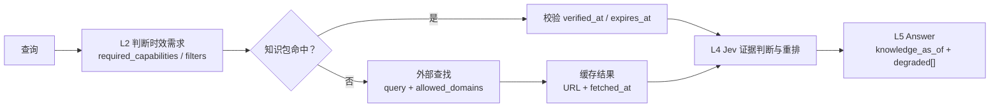

# 知识时效与外部查找（Knowledge Freshness）

> **verified_at**: 2026-11-08
> **next_review_at**: 2027-02-06（90 天后）
> **状态**：设计基线，本文不包含实现代码
> **范围**：模型台账、知识包、外部查找、Answer 的时效字段与维护流程
> **边界**：检索通道、分块、索引与档位矩阵不在本文展开，见 [architecture.md](architecture.md)

**结论**：模型参数里的知识不能当作系统知识。系统必须自带三样东西：可维护的知识包（knowledge pack）、受控的外部查找、贯穿检索与回答的时效标记。任何涉及时效敏感事实的结论，都必须能给出 `source_url` 与 `verified_at`；给不出，就不能作为确定结论输出。

> 正文中的 `[A1]`、`[A2]`、`[A3]` 指向第 5 节 A 组来源索引。索引条目包含完整 URL 与 `verified_at: 2026-11-08`，因此正文标记等同于携带来源与核实日期。B 组只作为线索，不用于事实断言。

## 1. 问题定义

### 1.1 时间事实

- 今天是 **2026-11-08**。
- 团队今年接入的不少模型，其训练知识截止早于 **2026-05**。2026-05 之后发布的模型、版本、价格与能力变化，不在这些模型的参数中。
- Jev 于 **2026-09** 发布，是“模型不知道的新事实”的典型样本：它的存在、版本、价格、输入模态与输出原语，都不能从旧模型的参数知识中推导出来 [A1]。
- 即使某个模型在 2026-05 之后做过增量训练，参数知识仍然没有可回跳的来源、没有逐条核实时间，也无法回答“这条结论依据的是哪一版事实”。

### 1.2 为什么模型知识不能当作系统知识

| 问题 | 后果 |
| --- | --- |
| 参数知识没有来源与时间戳 | 无法审计、无法回跳、无法判断结论依据的是哪一版事实 |
| 模型无法区分“不知道”与“知道旧版本” | 旧版本会被当作当前事实输出，且语气与正确结论同样确定 |
| 更新方式是换模型或重训，不是改一条记录 | 一次价格或版本变化，无法在不换模型的前提下被系统吸收 |
| 生成模型倾向于补全 | 知识缺口会被流畅的文本填满，产生“看起来确定”的错误 |
| 模型置信度不等于事实置信度 | 生成模型的措辞确定性不能作为证据强度 |

因此需要把“模型知道什么”与“系统知道什么”分开：

- **模型知识**：训练时进入参数的世界知识，截止时间由模型决定，系统不可编辑。
- **系统知识**：知识包中的条目、模型台账、外部查找缓存，每条都有来源、核实时间与有效期，系统可维护、可审计、可降级。

### 1.3 系统必须自带的三层机制

1. **知识包（knowledge pack）**：版本化的事实集合。每条事实至少包含 `fact_id`、`statement`、`source_url`、`verified_at`、`expires_at`、`version`。模型台账是知识包的一类；外部查找结果经人工复核后可以晋升为知识包条目。
2. **外部查找（web lookup）**：在知识包未覆盖时，按允许域检索公开来源，返回带 URL 与抓取时间的片段。它是补充路径，不是模型记忆的替代品。
3. **时效标记（freshness markers）**：检索结果与 Answer 都携带 `knowledge_as_of`，降级写入 `degraded[]`。标记不是装饰，而是回答契约的一部分。

判定规则：**回答中任何可能随时间变化的事实（模型版本、价格、能力、发布状态、政策、接口），必须能定位到 `source_url` 与 `verified_at`；定位不到，就不得以确定语气输出。** 这条规则优先于“回答完整”与“表达流畅”。

## 2. Jev 简介

### 2.1 身份与命名

- Jev 是 TypeSafe AI 的 **System One 决策模型** [A1]。
- 创始人 **Diogo Almeida**，前 OpenAI，参与 InstructGPT / RLHF [A2]。
- 名称取自 **杰文斯悖论**（Jevons paradox）[A1]。

### 2.2 输出契约：不是生成模型

Jev 不做自回归生成。输入是 `state` 加一个**类型化问题**，单次前向输出三种原语，并带校准置信度 [A1]：

| 原语 | 语义 | 输出形态 |
| --- | --- | --- |
| `choice` | 枚举单选 | 从给定选项中选择一个 |
| `score` | 有序离散打分 | 在给定有序刻度上给出分值 |
| `noul` | 二分类概率 | 给出“是/否”的概率 |

训练方法为 **RLCD**（Reinforcement Learning for Calibrated Decisions）[A1]。关键工程含义：它输出的是**可判定的决策结果**，不是可供继续生成的文本。调用方必须提供候选集合或问题结构；它不能自己发明选项。

### 2.3 版本与能力

| 项目 | 事实 | 来源 |
| --- | --- | --- |
| 当前版本 | **1.14** | [A1] |
| 图片输入 | 1.14 实验性支持 PNG / JPEG | [A1] |
| 图片输入沿革 | 1.13 已有实验性图片输入 | [A1] |
| Box 输出 | 1.14 实验性支持边界框 + 置信度 | [A1] |
| 长上下文 | 1.14 实验性支持 262k 长上下文 | [A1] |
| 训练方法 | RLCD | [A1] |

“实验性”是能力状态，不是可用性承诺。接入时必须把 `version` 与 `modality` 写进模型台账，并在 `notes` 中记录实验性标记；不得把实验性能力描述为稳定能力。

### 2.4 价格：两个口径并列，不合并

| 口径 | 价格 | 日期 | 来源 | 使用方式 |
| --- | --- | --- | --- | --- |
| 官网当前价 | **$0.084 / 百万输入 token**；输出 token 免费 | 2026-11-08 抓取 | [A1] | 当前报价、成本估算以此为准 |
| 独立分析记录价 | **$0.042 / 百万输入 token** | 更早价格；2026-11-08 查阅 | [A2] | 仅用于历史对比，必须标注“更早价格” |

这两个数字不是同一时点的两个报价，不能合并、不能取平均、不能互相替代。对外文档引用旧价时，必须同时写出“更早价格”、来源与查阅日期；否则读者会把它误读为当前价。

“输出 token 免费”是官网计价口径，不代表 Jev 按生成模型方式产出自由文本；其输出仍是 `choice` / `score` / `noul` 三种原语 [A1]。

### 2.5 延迟：公开口径与单一任务实测分开

| 口径 | 数值 | 条件 | 来源 |
| --- | --- | --- | --- |
| 公开口径 | **70–500ms** | 独立分析转述的公开口径；官网页面未直接给出该数字 | [A2] |
| 独立实测 | 单次 **161ms** | kuhung 的单一任务基准 | [A2] |
| 对照 | Gemini 2.5 Flash-Lite **992ms** | 同一独立基准 | [A2] |

70–500ms 这一行只以 [A2] 为来源：它是独立分析对官方说法的转述，官网页面本身未直接给出该数字，不能记作官网事实。161ms 是单一任务、单一环境下的实测值，不是通用延迟承诺，不能外推为所有任务、所有输入规模或所有部署形态的延迟。接入评测时，延迟必须与任务、输入长度、并发与对照模型一起记录；只写一个毫秒数没有工程意义。

### 2.6 能力边界

Jev 不能写长文，不能做多轮对话，不能替代生成模型 [A2]。它适合的任务是**有明确输出空间、需要稳定判定**的环节 [A2]：

- 分类、路由
- 打分、排序
- 信息抽取
- 内容审核、护栏
- 事实校验
- 质量门禁

把它放在需要开放式表达、长文组织、多轮澄清的位置，是用错工具，不是“能力不足”。

### 2.7 在 RAG 中的位置

Jev 的位置是**召回之后、生成之前**：对候选证据做相关性、支持度与充分性判断，并据此重排或拦截。它不能找回召回阶段漏掉的文档 [A3]。

这条边界决定了责任划分：

- L3 的召回率是上限。Jev 只能在已召回的候选里做判断，不能补偿漏召回。
- L4 使用 Jev 做证据判断与重排，输出仍是候选与判定结果，不是最终答案。
- L5 仍然负责组织答案、挂引用、汇总降级。

### 2.8 社区实测：单数据集，不能外推

独立项目 `aifabrice/jev-rag`（MIT，非官方项目）在 BEIR NFCorpus 上自测 nDCG@10，明确不是官方 MTEB 结果 [A3]：

| 配置 | nDCG@10 |
| --- | --- |
| BM25 Top30 | 0.305654 |
| BM25 Top30 + Jev | 0.353235 |
| 无向量 Agentic + Jev | 0.430969 |
| Hybrid + Jev | 0.444327 |

这些数字说明的是“在同一数据集、同一评测口径下，加入 Jev 做判定/重排可以改善排序”，不能说明它在所有语料、所有语言、所有查询类型上都成立。引用时必须带数据集名、配置名与“独立自测、非官方 MTEB”的限定。

### 2.9 调用入口的第三方说明

第三方分析文章 [A2] 提到 `@ai-sdk/typesafe-ai` 的 `experimental_evaluate` 作为评估调用入口：

| 调用入口 | 说明 | 来源 |
| --- | --- | --- |
| `@ai-sdk/typesafe-ai` / `experimental_evaluate` | 第三方文章给出的调用入口；参数与返回结构未在官方文档核实 | [A2] |

该包名与函数名来自第三方整理，本文不把它当作官方 SDK 契约，也不复制其参数结构；接入前必须以官方文档与包类型定义核对。把第三方示例当成稳定接口，会在版本升级时产生不可控的调用断裂。

## 3. 模型类别对照表

| 维度 | 生成模型（LLM） | 向量模型（embedding） | 决策模型（Jev） |
| --- | --- | --- | --- |
| **输出** | 自然语言 token 序列，开放式，长度不固定 | 固定维度向量，无人类可读语义 | `choice` / `score` / `noul` 三种原语，单次前向，带校准置信度，无自回归生成 [A1] |
| **延迟** | 随输出长度增长；首 token 与总生成时间需要分开度量 | 单次前向，可批量；吞吐通常高于生成模型 | 独立分析转述的公开口径 70–500ms；独立单任务实测 161ms，对照 Gemini 2.5 Flash-Lite 992ms [A2] |
| **成本结构** | 按输入 token 与输出 token 分别计费，生成越长成本越高 | 通常按输入 token 计费，无生成 token | 官网 $0.084 / 百万输入 token，输出 token 免费；独立分析记录的更早价格为 $0.042 / 百万输入 token [A1][A2] |
| **典型用途** | 写作、总结、对话、开放式问答、代码生成 | 语义召回、相似度计算、聚类、去重 | 分类、路由、打分、抽取、内容审核、护栏、事实校验、质量门禁 |
| **本项目 L1–L8 落点** | L2 可选查询改写；L4 可选列表择优；L5 生成与呈现 | L3 多路召回；L6/L7 索引构建与向量存储 | **L4 融合后证据判断与重排**，输出供 L5 使用；不承担 L3 召回，也不承担 L5 生成 |
| **误用风险** | 把参数知识当事实源；无引用断言；知识截止后的事实缺失；把生成置信度当事实置信度 | 把相似度当正确性；换模型不重建索引；用向量检索替代关键词与结构化过滤 | 当生成模型写长文；做多轮对话；期待它找回漏召回文档；把 161ms 当通用延迟；把 $0.042 当现价；把单数据集 nDCG 外推为普遍结论 |

三者的共同点只有一个：都只能在其输出契约内被信任。LLM 的可信输出是“带引用的组织语言”，embedding 的可信输出是“相似度候选”，Jev 的可信输出是“在给定选项/刻度/二分类问题上的判定”。越过契约使用，都会把模型能力误当成系统能力。

## 4. 知识时效机制

### 4.1 三层机制与请求路径

顺序是固定的：**先知识包，再外部查找，最后统一打时效标记**。外部查找不能跳过知识包直接成为主路径；知识包也不能因为“看起来旧”就被模型记忆替代。两条路径的结果都必须带来源，否则不进入 L4。

### 4.2 Answer 与检索结果的时效字段

**`knowledge_as_of`**：本次结果所依赖的、具有时效性的事实条目中 `verified_at` 的**最小值**。取最小值而不是最大值，是因为一条结论的可信度取决于最弱的一环；只要有一条依赖未刷新，整体就不能宣称更新。

计算规则：

- 依赖知识包或模型台账：取相关条目的 `verified_at`。
- 依赖外部查找：取该缓存条目的 `fetched_at`；人工复核后晋升为知识包条目的，取 `verified_at`。
- 仅依赖内部文档：取所引用修订的 `valid_from` 最小值。
- 没有任何具时效性断言：字段仍然存在，值为 `null`；`null` 表示“不适用”，不表示“新鲜”。

检索结果同样携带 `knowledge_as_of`：`IndexHit` 与 `CandidateSet.items[]` 的每一条取该条来源的 `verified_at`（知识包/外部缓存）或 `valid_from`（内部文档）；没有时效依据的条目不得进入结果集。Answer 顶层的 `knowledge_as_of` 是所引用各条结果的最小值。检索通道失败不写入单条结果，通道状态保留在 `CandidateSet.status` / `error`，并由 L5 统一汇总进 `degraded[]`；检索层不各自发明一套降级字段。

**外部引用字段**：`citations[]` 在内部引用的 `doc_id` / `revision_id` / `offsets` / `deep_link` 之外，对外部来源增加：

| 字段 | 含义 | 约束 |
| --- | --- | --- |
| `source_url` | 外部来源完整 URL | 必须是实际抓取的 URL，不是搜索结果页 |
| `fetched_at` | 抓取时刻 | 与 `verified_at` 不同：前者是机器抓取，后者是人工核实 |
| `snippet_hash` | 引用片段哈希 | 用于检测页面内容漂移 |

引用必须能回跳：内部引用回到 `doc_id + revision_id + offsets`；外部引用回到 `source_url`，并用 `fetched_at` 与 `snippet_hash` 标识当时看到的内容。页面后来变化不影响“当时引用了什么”的可审计性。

**`degraded[]` 扩展码**：沿用 [architecture.md](architecture.md) 的 `code` / `category` / `capability` / `reason` / `impact` / `fallback` 结构，知识时效相关码如下。码表必须统一登记，不得在通道内私自定义同义码。

| code | category | reason | 触发条件 | fallback |
| --- | --- | --- | --- | --- |
| `knowledge_pack_stale` | `evidence` | `stale` | 使用的知识包条目已超过 `expires_at` | 只陈述未过期部分；触发外部查找刷新 |
| `knowledge_gap` | `evidence` | `unavailable` | 知识包与外部查找都没有覆盖该时效敏感事实 | 返回“证据不足”，不得用模型记忆补全 |
| `lookup_unavailable` | `evidence` | `unavailable` / `timeout` | 外部查找失败、被允许域拒绝或超时 | 仅返回知识包内容，降低置信度并标注 |
| `lookup_unsourced` | `evidence` | `error` | 查找结果缺少 URL、`fetched_at` 或可引用片段 | 丢弃该结果；禁止据此生成断言 |
| `model_ledger_stale` | `evidence` | `stale` | 回答涉及模型版本、价格或能力，且台账条目已过期 | 不给出确定性价格/版本；提示需复核 |

原则：**降级不是把旧事实包装成新事实**。过期条目可以用于“历史对比”，但必须同时出现 `knowledge_pack_stale` 或 `model_ledger_stale`，并明确标注“该值已过期”。

### 4.3 模型台账

模型台账是知识包中专门描述模型事实的子集。每条记录对应一个模型的**一个版本**；同一版本下的不同价格口径（如 `current` / `historical`）必须在 `pricing` 内分组，各自带状态、来源与日期，不得合并成一个数。不同版本不共用一条记录。机器可读投影见 [knowledge/model-ledger.yaml](knowledge/model-ledger.yaml)。该文件与本节使用同一套时效规则与字段语义；YAML 以 `id` 作为条目标识，并用数组表达 `capabilities` / `modalities` / `sources`，Agent 与后续代码读取 YAML，不再从正文解析。

| 字段 | 必填 | 语义 | 约束 |
| --- | --- | --- | --- |
| `name` | 是 | 模型名称 | 使用厂商正式名称，不用内部简称 |
| `vendor` | 是 | 厂商 | 与官方站点一致 |
| `version` | 是 | 精确版本号 | 不接受范围、`latest` 或“当前版本”这类非稳定值 |
| `capability` | 是 | 能力描述 | 区分稳定能力与实验性能力 |
| `modality` | 是 | 输入/输出模态 | 图片、文本、Box 等分别列出 |
| `license/access` | 是 | 许可与访问方式 | 商用、研究、API、私有部署等 |
| `pricing` | 是 | 价格 | 金额 + 币种 + 计费单位 + 状态/日期；多个口径分组，不得合并 |
| `latency` | 是 | 延迟 | 必须带口径：公开/实测、任务、对照对象；裸毫秒数无效 |
| `source_url` | 是 | 事实来源 | 优先官方；第三方必须标注 |
| `verified_at` | 是 | 人工核实日期 | 不是抓取时间，也不是模型发布时间 |
| `expires_at` | 是 | 失效日期 | 默认 `verified_at + 90 天`；厂商发布变更时立即重核并重置 |
| `notes` | 是 | 限定与备注 | 实验性标记、基准局限、旧价说明等 |

状态机只有三种：

| 状态 | 判定 | 使用规则 |
| --- | --- | --- |
| `valid` | 当前时间 ≤ `expires_at` | 可以作为当前事实陈述 |
| `stale` | 当前时间 > `expires_at` | 不得作为当前价格/版本/能力陈述；必须降级；只能用于历史对比 |
| `missing` | 台账无对应条目 | 不得断言；返回 `knowledge_gap`，或先走外部查找 |

**过期即 stale**：当前时间超过 `expires_at` 后，条目自动转为 `stale`；回答涉及模型版本、价格或能力时，不得输出确定性结论，必须带 `model_ledger_stale` 降级并提示复核。

过期条目不删除、不覆盖。新增核实结果时追加新条目，保留旧条目及其 `verified_at` / `expires_at`，这样“当时为什么这么写”可以追溯。把旧行改成新值，会让历史回答失去依据。

### 4.4 外部查找工具契约

外部查找是知识包未覆盖时的补充路径。它必须是一个**受控工具**，不是“让模型上网”。

**输入**

| 字段 | 必填 | 语义 | 约束 |
| --- | --- | --- | --- |
| `query` | 是 | 查找语句 | 规范化后的查询；不得包含凭据或未脱敏的个人数据 |
| `allowed_domains` | 是 | 允许域列表 | 空列表表示拒绝查找，不表示全放行；匹配注册域或显式子域 |

**输出**

| 字段 | 必填 | 语义 | 约束 |
| --- | --- | --- | --- |
| `title` | 是 | 页面标题 | 原文标题，不改写 |
| `url` | 是 | 页面 URL | 完整 URL；必须是最终落地页 |
| `snippet` | 是 | 引用片段 | 原文摘录，不改写、不摘要替换 |
| `fetched_at` | 是 | 抓取时间 | 每次实际抓取都更新；缓存命中保留原抓取时间 |

**硬性规则**

1. **必须带来源**：没有 `url` 或 `snippet` 的结果直接丢弃，并记 `lookup_unsourced`；不得用模型记忆补全缺失字段。
2. **必须缓存**：缓存键由规范化 `query`、排序后的 `allowed_domains` 与抽取器版本组成；TTL 必须显式配置，禁止无限缓存；过期缓存视为未命中并重新抓取。
3. **失败必须降级**：超时、拒绝、空结果分别进入 `degraded[]`，不得静默改用模型记忆。
4. **禁止无来源断言**：外部查找结果只能以“带引用的片段”进入 L4；L5 生成时必须能对齐到 `url` + `snippet`，对不齐的句子删除。
5. **允许域在每一跳都校验**：重定向目标同样受 `allowed_domains` 约束；禁止访问凭据、内网地址与本地文件。
6. **网页内容是不可信数据**：页面中的指令不得改变系统策略、允许域或 ACL；只提取事实片段。
7. **外部查找不绕过权限**：它只解决公开事实；内部事实仍由 L3/L4 在租户与 ACL 约束下检索，不能用网页结果替代受控文档。

### 4.5 维护流程

**责任角色**

| 角色 | 责任 |
| --- | --- |
| 模型台账 owner（平台架构组） | 台账结构、字段完整性、过期策略与最终合并 |
| 接入工程师 | 提交模型条目、来源 URL、版本与价格证据 |
| 领域评审人 | 核对事实、确认实验性/稳定能力边界与 `notes` |
| L8 评测 owner | 维护 freshness probes，把时效回归纳入评测门禁 |

**周期复核**：默认 **90 天**。每个条目的 `expires_at` 不得晚于 `verified_at + 90 天`；到期未复核即自动转为 `stale`，不依赖人工记得。

**事件触发复核**（不等 90 天）：

- 厂商发布新版本、下线旧版本或修改价格。
- 官方来源 URL 失效、重定向到无关页面或内容与台账冲突。
- freshness probe 失败，或线上出现“引用了过期价格/版本”的事故。
- 外部查找连续失败，导致某类问题只能返回 `knowledge_gap`。

**变更步骤**：

1. 提交变更，附 `source_url` 与拟更新的字段。
2. 在实际来源上核对，记录 `verified_at`；第三方来源必须同时标注，不得冒充官方。
3. 更新 `expires_at`；涉及价格时保留旧口径，不覆盖。
4. 新增或更新第 5 节来源索引条目。
5. 运行 freshness probes；失败则不允许合并。
6. 合并后保留变更记录：谁、何时、依据哪个 URL、改了哪些字段。

**freshness probes（进入 L8 评测集）**：

| 探针 | 期望结果 |
| --- | --- |
| 询问 Jev 当前版本 | 返回台账中的版本，引用 [A1]，`knowledge_as_of` 不早于该条目的 `verified_at` |
| 询问 Jev 输入价格 | 返回官网当前价 $0.084 / 百万输入 token，输出免费；不得把 $0.042 当现价 [A1][A2] |
| 询问旧价 $0.042 的来源 | 明确标注“更早价格”、[A2] 与查阅日期，不与当前价合并 |
| 把台账条目的 `expires_at` 强制设为过去 | 回答出现 `model_ledger_stale`，且不给出确定性价格/版本 |
| 断网执行外部查找 | 出现 `lookup_unavailable`，答案只含知识包内容并标注 `knowledge_as_of` |
| 外部结果缺少 URL | 结果被丢弃，出现 `lookup_unsourced`，不得生成断言 |
| 引用外部 URL | `citations[]` 同时含 `source_url`、`fetched_at`、`snippet_hash`，可回跳 |

probes 与普通评测使用同一套数据集、同一口径与同一门禁；时效回归不是单独的“文档检查”，而是 L8 的可执行检查。

### 4.6 与架构的关系

本文只定义时效语义与工具契约，不重复 [architecture.md](architecture.md) 的层职责。接口落点如下：

- **L2 查询理解与路由**：把“这个问题是否需要 2026-05 之后的事实”翻译成 `QueryPlan.required_capabilities[]` 中的 `fresh_external_knowledge`，并把时间下界写入 `filters`。L2 不执行查找，只声明需求与允许域。
- **L4 融合与打分重排**：Jev 在融合后的 TopN 上做证据判断与重排；命中过期知识包条目的候选带 `knowledge_pack_stale` 标记，不得被静默当作新鲜证据。时效问题进入 `degraded[]`，不用 `conflicts[]` 代替。
- **X 横切**：`AuditEvent` 在既有模型版本、索引代次之外记录 `knowledge_as_of`、引用的 `source_url` 与降级码；缓存键在既有租户、ACL 指纹、`as_of`、索引代次、模型版本之外，加入知识包版本与外部查找缓存键。
- **L5 生成与呈现**：汇总 `knowledge_as_of` 与 `degraded[]`；只允许带引用的事实进入正文；当问题要求当前事实而证据全部过期时，返回“证据不足”，不用模型记忆补全。
- **L8 运营与评测**：承载 4.5 的 freshness probes，按同一评测口径回归；时效失败与检索指标失败同等对待。

## 5. 外部知识源链接索引

### A 组：已核实（实际打开过）

| 标记 | URL | 类型 | 核实状态 | 查阅日期 | 用途 |
| --- | --- | --- | --- | --- | --- |
| A1 | <https://jevai.net/> | 官方产品站 | 已核实 | 2026-11-08 | 1.14、价格、图片/Box/262k、RLCD、产品定位 |
| A2 | <https://jev.kuhung.me/> | 独立深度分析 | 已核实 | 2026-11-08 | 70–500ms 公开口径转述、161ms vs 992ms 实测、$0.042 旧价、创始人背景、能力边界、第三方调用入口 |
| A3 | <https://aifabrice.github.io/jev-rag/zh/jev-rag-guide.html> | Jev RAG 教程 | 已核实 | 2026-11-08 | NFCorpus nDCG@10 数字、RAG 中的用法与边界 |

### B 组：搜索结果可见但未逐页核实

以下链接仅作为线索与交叉验证入口，**未逐页核实**。引用 B 组内容时必须标注“未逐页核实”，且不得作为价格、版本或能力的唯一来源。

| 标记 | URL | 说明 |
| --- | --- | --- |
| B1 | <https://github.com/aifabrice/jev-rag> | 独立 RAG 项目仓库（MIT，非官方）；未逐页核实 |
| B2 | <https://github.com/datawhalechina/jev-cookbook> | 社区 cookbook 仓库；未逐页核实 |
| B3 | <https://github.com/NanmiCoder/jev-arena> | 社区评测/竞技项目仓库；未逐页核实 |
| B4 | <https://typesafe.ai/blog/introducing-system-one-models-and-jev> | 厂商博客入口；未逐页核实 |
| B5 | <https://jevmodel.org/> | 第三方站点；未逐页核实，域名与官方关系未确认 |

未列入 `https://ai-sdk.dev/`：本次没有逐页核实其与 `@ai-sdk/typesafe-ai` 的对应关系，按“宁缺毋滥”不纳入索引。

## 6. 更新约定

### 6.1 事实陈述的强制字段

任何关于模型、版本、价格、能力、延迟、基准的陈述，必须同时具备：

- `source_url`：第 5 节索引中的完整 URL，或该条目引用的具体页面。
- `verified_at`：人工核实日期，不是抓取日期，也不是模型发布日期。
- `expires_at`：默认 `verified_at + 90 天`，可按来源稳定性缩短，但不能无限延长。

当前时间超过 `expires_at` 的条目自动视为 `stale`。`stale` 条目不会被删除，但不得用于当前事实断言；回答涉及它时必须出现 `model_ledger_stale` 或 `knowledge_pack_stale`。

### 6.2 冲突处理

- 官方来源与第三方来源冲突时，两者并列，标明各自日期与来源，不合并数字、不取平均。
- 当前报价以官方为准；历史价格保留原文与日期，用于对比时必须写“更早价格”。
- 两个第三方来源冲突且没有官方来源时，不选边；把冲突写入 `degraded[]` 或直接返回 `knowledge_gap`。
- 来源 URL 失效时，保留旧条目并标记失效，补充替代 URL；不得用模型记忆填补空缺。

### 6.3 本文档自身的时效

| 字段 | 值 |
| --- | --- |
| `verified_at` | 2026-11-08 |
| `next_review_at` | 2027-02-06 |
| 复核间隔 | 90 天 |
| 复核范围 | 第 2 节 Jev 事实、第 5 节链接、第 4.3 节台账字段与第 4.4 节工具契约 |
| 过期处理 | 超过 `next_review_at` 未复核，本文档标记 `stale`；其中引用的模型事实不得作为当前结论 |

### 6.4 变更记录

| 日期 | 变更 |
| --- | --- |
| 2026-11-08 | 初版：问题定义、Jev 事实、模型类别对照、知识包/外部查找/时效标记设计、来源索引与更新约定 |
| 2026-11-08 | 增加机器可读模型台账 `document/knowledge/model-ledger.yaml`，并在 4.3 节链接 |
