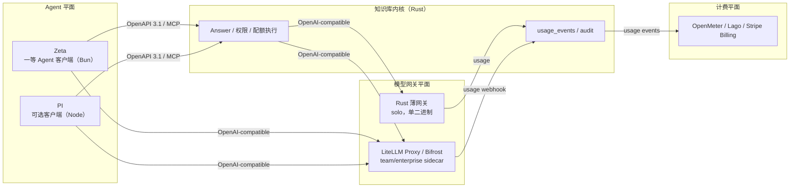

# 模型网关、计量、配额与计费（设计）

> 状态：设计基线
> 关联决策：[ADR 0008](adr/0008-model-gateway-and-billing.md)
> 关联评估：[gap-assessment.md](gap-assessment.md)、[architecture.md](architecture.md)
> 范围：公开模型别名、供应商池、缓存统计、usage、quota、钱包/账本与管理接口。本文只定义契约，不写实现。

## 1. 目标与边界

| 目标 | 说明 |
| --- | --- |
| 对外稳定模型名 | 客户端只看到 `model_aliases.public_id`；不暴露 provider、base_url、upstream_model |
| 多供应商池 | 同一 alias 可挂多个 provider_model；按访问策略、健康、优先级、权重路由，失败重试/切池 |
| 用量可见 | 按 user / space / tenant 统计 input/output/cached tokens、成本、延迟、缓存命中 |
| 配额可控 | tenant/space/user/role 四种 scope；hard/soft；调用前预留，超限 429 |
| 未来可商业化 | 预付钱包、双分录账本、plans/topups/invoices；默认关闭商业开关 |
| 安全 | 密钥只写不回显；provider 错误不泄漏内部拓扑；计费不可由客户端伪造 |
| 缓存不越权 | 精确缓存键包含 ACL 指纹与索引代次；语义缓存可选且不跨租户 |

不在本文范围：具体支付渠道的签约与合规、税务、发票样式、provider 商务合同；这些在 P2 之后单独立项。

## 1.1 目标架构（结论）

| 平面 | 决策 |
| --- | --- |
| Agent 平面 | Zeta 作为一等 Agent 客户端，经 OpenAPI/MCP 调 KB；PI 作为可选第二客户端。**不把任何 agent runtime 嵌进 Rust 内核。** |
| 网关平面 | team/enterprise 用现成 LLM gateway（首选 LiteLLM Proxy，Bifrost 备选）作为可选 sidecar，统一 provider 配置、路由/fallback、tokenizer、缓存、虚拟 key 与预算；solo 保留 Rust 薄网关 + tokenizer 库（如 tiktoken-rs，需核实），保持单二进制、零外部依赖。 |
| 计费/配额平面 | solo 用 Rust `usage_events` + 硬配额；team/enterprise 用 OpenMeter/Lago 或 Stripe Billing 管钱包/发票/支付；KB 只发 usage 事件，不手写支付。 |
| 计量真相源 | KB 的 `usage_events` 是 token 用量与配额执行的真相源；gateway 的 usage 日志作为 provider 侧对账源；计费引擎是财务账本的真相源。三者用 request_id / external_usage_id 对齐。 |
| 身份/密钥/审计 | 仍归 KB：Principal、API key、provider 密钥、审计 actor 不交给 agent runtime 或网关。 |
| 不手写边界 | Agent 编排/会话/工具用 Zeta/PI；provider 适配/tokenizer 用网关；支付/发票/催收用计费引擎；我们只写计量、配额、审计、权限。 |

### 1.1.1 为什么 Zeta 是一等客户端、PI 是可选

| 事实 | Zeta | PI |
| --- | --- | --- |
| 运行时 | Bun agent runtime | Node >= 22.19 |
| 许可 | 未核实（本任务未取得许可证文件） | MIT（公开仓库） |
| 现成能力 | providers/models.yml、AuthStorage、ModelRegistry、Session、MCP、RPC、SDK、stats dashboard（usage/cost/requests/traces） | providers/models.json、SDK/RPC、会话 token usage/cost、provider 登录、工具/扩展 |
| 多租户计费 | 无；provider quota window 是上游套餐展示，不是多租户计费引擎 | 无 |
| 结论 | 一等客户端：复用 agent 会话/工具/统计，不作为 KB 运行时 | 可选客户端：仅在 coding agent 场景接入，不进入默认构建 |

Zeta 的 `providers/models.yml` 与统计可作为迁移输入与对账参考，但运行时应统一走网关的 OpenAI-compatible endpoint，避免 Zeta、PI、KB 三套 provider 配置与三套 token 账。

### 1.1.2 为什么网关用现成实现

LiteLLM Proxy 公开文档覆盖 virtual keys、budgets/rate limits、cache 与 OpenAI-compatible API；Bifrost 公开文档覆盖 20+ provider、OpenAI-compatible API 与 fallback 链。两者都适合 team/enterprise 的 sidecar 形态。**版本与许可证需在选型时核实**，本文不把未核实的版本/许可写成事实。

结论：team/enterprise 首选 LiteLLM Proxy（virtual key/budget/usage 与多租户诉求更接近）；Bifrost 作为 Go/轻量替代；solo 不引入 Python/Go sidecar，使用 Rust 薄网关。

## 2. 公开模型 vs 供应商池

### 2.1 概念

| 概念 | 作用 |
| --- | --- |
| Alias（公开模型） | 客户端请求的稳定 `public_id`，如 `chat-default`；携带能力、访问策略、对外价格 |
| Provider | 一个 API 供应方或同一供应方的独立端点；含 base_url、密钥引用、限流与超时 |
| Provider Model | provider 上的具体 upstream model；含上下文、内部成本、能力 |
| Route | alias 到 provider_model 的可用路径；含权重、优先级、健康与熔断状态 |

### 2.2 数据模型

**model_aliases**

| 字段 | 类型 | 必填 | 说明 |
| --- | --- | --- | --- |
| `public_id` | string | 是 | 对外模型名；主键；稳定，不随 provider 变化 |
| `display_name` | string | 是 | 管理端展示名 |
| `capabilities` | json | 是 | `chat` / `embedding` / `vision` 等；用于路由匹配 |
| `status` | enum | 是 | `active` / `disabled` |
| `access_policy` | json | 是 | 允许的 tenant / space / role；缺省拒绝 |
| `price` | json | 是 | 对外价格：input/output 每 1M token 的 micros 与 currency |
| `version` | integer | 是 | 配置版本；修改价格/策略时递增 |
| `created_at` / `updated_at` | timestamp | 是 | 生命周期 |

**providers**

| 字段 | 类型 | 必填 | 说明 |
| --- | --- | --- | --- |
| `provider_id` | string | 是 | 主键；管理端可见，客户端不可见 |
| `kind` | enum | 是 | `openai_compatible` / `anthropic` / `custom` 等 |
| `base_url` | string | 是 | API 根地址；客户端不可见 |
| `api_key_ref` | string | 是 | secret manager / 加密存储引用；不存明文 |
| `status` | enum | 是 | `active` / `disabled` / `draining` |
| `weight` | integer | 是 | 同优先级下的加权比例 |
| `priority` | integer | 是 | 数值小优先；用于主/备 |
| `limits` | json | 是 | RPM / TPM / 并发 / 日预算等 |
| `timeouts` | json | 是 | connect / read / total 超时 |
| `created_at` / `updated_at` | timestamp | 是 | 生命周期 |

**provider_models**

| 字段 | 类型 | 必填 | 说明 |
| --- | --- | --- | --- |
| `provider_model_id` | string | 是 | 主键 |
| `provider_id` | string | 是 | 外键到 providers |
| `upstream_model` | string | 是 | provider 侧模型名；仅管理端可见 |
| `context_window` | integer | 是 | 上下文上限 |
| `pricing` | json | 是 | 内部成本：input/output 每 1M token 的 micros 与 currency |
| `capabilities` | json | 是 | 实际支持的能力；与 alias 能力取交集 |
| `status` | enum | 是 | `active` / `disabled` |
| `created_at` / `updated_at` | timestamp | 是 | 生命周期 |

唯一键：`(provider_id, upstream_model)`。

**routes**

| 字段 | 类型 | 必填 | 说明 |
| --- | --- | --- | --- |
| `route_id` | string | 是 | 主键 |
| `alias_public_id` | string | 是 | 外键到 model_aliases |
| `provider_model_id` | string | 是 | 外键到 provider_models |
| `weight` | integer | 是 | 路由权重 |
| `priority` | integer | 是 | 路由优先级；与 provider priority 共同决定顺序 |
| `health` | enum | 是 | `healthy` / `degraded` / `open` |
| `circuit_state` | enum | 是 | `closed` / `open` / `half_open` |
| `last_error_at` | timestamp | 否 | 最近失败时间 |
| `circuit_open_until` | timestamp | 否 | 熔断恢复时间 |
| `created_at` / `updated_at` | timestamp | 是 | 生命周期 |

唯一键：`(alias_public_id, provider_model_id)`。

### 2.3 解析顺序

1. **Alias**：按 `public_id` 查 active alias；不存在/disabled → `model_unavailable`。
2. **访问策略**：按 tenant / space / role 判定；未授权 → 403 `model_forbidden`，不暴露路由存在性。
3. **候选路由**：alias 下 provider/model active 且 `health != open` 的路由；无候选 → `model_unavailable`。
4. **排序**：先按 priority、再按 weight 加权随机；同 provider 的多路由按 health 降级。
5. **调用**：使用 provider timeouts；请求只携带 upstream_model 与密钥引用，不把 provider 信息返回给客户端。
6. **重试/切池**：对 429、5xx、连接超时重试下一个路由；对 400/401/403 等确定性错误不盲目重试；达到上限后开熔断。
7. **映射**：响应统一映射为 alias；Answer 的 `model` 字段只写 alias；usage 内部记录 `provider_model_id`。
8. **失败**：provider 错误脱敏为公开错误码（`model_unavailable` / `model_timeout` / `model_rate_limited`），不返回 base_url、upstream_model、密钥或内部堆栈。

管理端可见 provider 与 upstream_model；普通用户/Agent 只看到 alias。日志中如必须关联 provider，使用 `provider_ref_hash` 或内部 ID，不写 base_url/密钥。

**运行时归属**：solo 由 Rust 薄网关执行上述解析；team/enterprise 由 LiteLLM/Bifrost 执行同一 alias→route 语义。KB 的 `model_aliases` / `providers` / `provider_models` / `routes` 是控制面与观测投影，部署时同步到网关，避免 KB、Zeta、PI 各维护一套 provider 配置。网关的 usage 日志回传 KB，由 KB 统一成 `usage_events`。

## 3. 缓存

### 3.1 精确缓存键

| 键分量 | 说明 |
| --- | --- |
| `tenant_id` | 租户隔离；不得跨租户 |
| `space_id` | 空间隔离 |
| `alias` | 公开模型名；不同 alias 不共享 |
| `prompt_hash` | 规范化 prompt 的 SHA-256 |
| `params_hash` | temperature / max_tokens / stop / top_p 等生成参数哈希 |
| `prompt_version` | prompt 模板版本；模板变化即失效 |
| `acl_fingerprint` | 主体 ACL / 策略版本指纹；ACL 变化即失效 |
| `index_generation` | 检索索引代次；重建即失效 |

缓存值保存 Answer、citations、usage、alias 与创建时间。缓存查询在认证之后执行；命中后仍做一次 ACL 复核（L4），失败则丢弃并记 `cache_acl_mismatch`，不得返回越权引用。

**归属**：Answer 级精确缓存由 KB 负责，因为只有 KB 持有 ACL 指纹与索引代次；LiteLLM/Bifrost 的响应缓存只作为 provider 调用级优化，不得替代 KB 的 ACL-aware Answer 缓存。solo 两者都在 Rust 薄网关/内核内完成。

### 3.2 失效与统计

| 项 | 契约 |
| --- | --- |
| TTL | 按 alias/空间配置；过期即未命中 |
| 失效 | ACL 指纹、索引代次、prompt_version、alias version 变化时失效；支持手动 purge |
| 精确命中 | 同键返回缓存 Answer；usage 写 `cache_hit=true`、`cached_tokens` 为节省 token、provider cost 为 0 |
| 语义缓存 | P2 可选；embedding + 阈值；键必须含 tenant/space/ACL 指纹；默认关闭；不跨租户 |
| 统计 | 命中/未命中、节省 input/output tokens、节省成本、按 alias/user/space/tenant 聚合 |
| 计费 | 缓存命中默认不计 provider token；商业化时可按 alias 的 `cache_price_factor` 配置，默认 0 |
| 禁止 | 不得用全局缓存绕过 ACL；不得把其他租户/空间的 Answer 复用 |

## 4. 计量

### 4.1 usage_events

| 字段 | 类型 | 必填 | 说明 |
| --- | --- | --- | --- |
| `usage_event_id` | string | 是 | 主键；追加写 |
| `request_id` | string | 是 | 请求追踪 |
| `tenant_id` / `space_id` / `user_id` | string | 是 | 归属与聚合维度 |
| `role` | string | 是 | 调用时角色 |
| `source` | enum | 是 | `kb` / `agent_runtime`；区分 KB 调用与 Zeta/PI 回传 |
| `external_usage_id` | string | 否 | 外部 Agent 的用量 ID；按 tenant+source 幂等 |
| `alias` | string | 是 | 公开模型名；Agent 回传可用 `agent:<runtime>` |
| `provider_model_id` | string | 是 | 内部路由模型；仅管理端可见；外部 Agent 可用 `external:<hash>` |
| `input_tokens` | integer | 是 | 输入 token；provider usage 优先 |
| `output_tokens` | integer | 是 | 输出 token；provider usage 优先 |
| `cached_tokens` | integer | 是 | 缓存命中节省的 token；未命中为 0 |
| `token_source` | enum | 是 | `provider` / `estimated` / `mixed` |
| `cost` | integer | 是 | 对外计费金额；integer micros |
| `currency` | string | 是 | 币种 |
| `provider_cost` | integer | 是 | 内部成本；integer micros；管理端可见 |
| `latency_ms` | integer | 是 | 端到端延迟 |
| `status` | enum | 是 | `success` / `error` / `timeout` / `quota_blocked` / `cache_hit` |
| `cache_hit` | boolean | 是 | 是否命中缓存 |
| `at` | timestamp | 是 | 发生时间 |

token 计数优先使用 provider 返回的 usage；缺失时用与模型匹配的 tokenizer 估算，写 `token_source=estimated`。solo 可选用 `tiktoken-rs`（许可/版本需核实）；team/enterprise 优先用 LiteLLM/Bifrost 的 tokenizer 结果。估算方法/版本进入内部元数据，账单必须能解释“为什么与 provider 账单不同”。usage 只追加，不更新历史行；聚合结果可重建。

**三路来源与去重**：

- KB 自身调用网关：网关 usage 日志作为 provider 侧原始数据，KB 写成 `source=kb` 的 `usage_events`。
- Zeta/PI 调 KB Answer：KB 已记录 `source=kb`，Agent 不再重复上报同一 request_id。
- Zeta/PI 自己的模型调用：通过 `POST /api/v1/usage/agent` 或 webhook 回传，写 `source=agent_runtime`，用 `external_usage_id` 幂等；只上报 Agent 自己的调用，不上报 KB Answer 内部调用。
- 同一 `request_id` 或 `external_usage_id` 重复上报时只保留首次；对账时以网关/provider usage 优先，Agent 自报只作补充。

### 4.2 聚合

- 按 user / space / tenant / alias / period 聚合 input/output/cached tokens、cost、provider_cost、请求数、错误率、P95。
- 缓存命中单独统计节省 token 与节省成本；不把缓存命中混入 provider token。
- 管理员可按租户/空间/用户/alias/时间范围筛选；普通用户只看到自己的 usage。
- 保留策略按租户配置；账单相关 usage 不得早于财务保留期删除。

## 5. 配额

### 5.1 quota_policies

| 字段 | 类型 | 必填 | 说明 |
| --- | --- | --- | --- |
| `policy_id` | string | 是 | 主键 |
| `scope_type` | enum | 是 | `tenant` / `space` / `user` / `role` |
| `scope_id` | string | 是 | 对应主体 ID |
| `period` | enum | 是 | `day` / `month` / `total` |
| `limit_tokens` | integer | 否 | token 上限；与 requests/cost 至少一项 |
| `limit_requests` | integer | 否 | 请求数上限 |
| `limit_cost` | integer | 否 | 金额上限；integer micros |
| `currency` | string | 是 | 金额币种 |
| `enforcement` | enum | 是 | `hard` / `soft` |
| `action` | enum | 是 | `block` / `alert` |
| `enabled` | boolean | 是 | 是否生效 |
| `created_at` / `updated_at` | timestamp | 是 | 生命周期 |

多个适用策略默认**同时生效**（tenant + space + user + role 都检查），任一 hard 超限即阻断；soft 只告警。管理员可用 `quota_overrides` 临时覆盖，必须带 actor、reason、expires_at 并写审计。

网关的 virtual key / budget 只作为 provider 级防线与熔断，不作为 tenant/space/user 配额的真相；KB 在调用前执行权威配额与预留，网关预算用于防止单 key 失控。

### 5.2 原子预留

| 阶段 | 行为 |
| --- | --- |
| 调用前 | 估算 input tokens + max_output，按 alias 价格估算 cost；在 `quota_counters` 原子增加 reserved tokens/requests/cost |
| 预留失败 | 返回 429 `quota_exceeded`，带 `Retry-After`（到周期重置或 override 到期）；不调用 provider |
| 成功 | provider usage 确定后提交 used，释放多余 reserved；写 usage_event |
| 失败/超时 | 释放 reserved；写 usage_event（status=error/timeout，成本按实际 usage 或 0） |
| 缓存命中 | 计 1 次 request；tokens/cost 默认 0；是否计入 requests 由 policy 配置 |
| 并发 | 计数更新必须在同一事务/行锁内；SQLite 与 PostgreSQL 语义一致 |

`quota_counters` 至少包含：scope_type、scope_id、period_start、reserved_tokens、used_tokens、reserved_requests、used_requests、reserved_cost、used_cost、updated_at；唯一键 `(scope_type, scope_id, period_start)`。`quota_reservations` 记录 request_id、reservation 金额/token、状态与过期时间，保证提交/释放幂等。

## 6. 计费（未来商业化；默认外接计费引擎）

默认不自建钱包/发票/支付：KB 只负责 `usage_events`、配额执行与审计，商业化接 OpenMeter / Lago / Stripe Billing 等计量计费系统。下面的 `wallets` / `ledger_entries` / `plans` / `topups` / `invoices` 是**自托管/离线适配器契约**，用于无外部计费引擎或测试环境，不是默认商业路径。

外接模式：KB 通过 `billing_engine` 适配器发送 usage 事件（OpenMeter/Lago）或同步订阅/发票（Stripe Billing）；充值、余额、发票、退款、催收由计费引擎负责。KB 只读缓存 entitlement/balance 快照用于调用前阻断，支付回调不直接改 KB 业务表；对账以 `usage_event_id` / `external_usage_id` / provider invoice id 对齐。

### 6.1 账户与账本（可选自托管适配器）

**wallets**

| 字段 | 类型 | 必填 | 说明 |
| --- | --- | --- | --- |
| `wallet_id` | string | 是 | 主键 |
| `tenant_id` | string | 是 | 归属 |
| `currency` | string | 是 | 币种 |
| `balance_micros` | integer | 是 | 可用余额；integer micros |
| `status` | enum | 是 | `active` / `frozen` / `closed` |
| `updated_at` | timestamp | 是 | 最近变更 |

**ledger_entries**

| 字段 | 类型 | 必填 | 说明 |
| --- | --- | --- | --- |
| `entry_id` | string | 是 | 主键 |
| `group_id` | string | 是 | 同一笔交易的两条分录共享 |
| `wallet_id` | string | 是 | 钱包 |
| `account` | string | 是 | `wallet` / `revenue` / `payment_clearing` / `refund` |
| `direction` | enum | 是 | `debit` / `credit` |
| `amount_micros` | integer | 是 | 金额 |
| `currency` | string | 是 | 币种 |
| `idempotency_key` | string | 是 | 唯一；防重复入账 |
| `request_id` | string | 否 | 关联 usage |
| `created_at` | timestamp | 是 | 发生时间 |
| `metadata` | json | 否 | 审计/对账辅助 |

双分录：每组 `sum(debit) = sum(credit)`；账本只追加，不更新/删除；冲正通过反向分录。usage 扣费、topup 入账、退款都走账本。

**plans / topups / invoices**

| 表 | 关键字段 | 说明 |
| --- | --- | --- |
| `plans` | plan_id、name、price_micros、included_tokens、currency、status | 套餐与包含 token |
| `topups` | topup_id、wallet_id、amount_micros、currency、channel、provider_ref、status、idempotency_key、created_at | 充值；支付回调幂等 |
| `invoices` | invoice_id、tenant_id、period_start、period_end、amount_micros、currency、status、created_at | 周期账单 |

### 6.2 价格与开关

- 对外价格来自 `model_aliases.price`：input/output 每 1M token 的 micros；内部成本来自 `provider_models.pricing`；两者分开记录，避免毛利不可见。
- 商业开关默认关闭：关闭时仍写 usage，不要求钱包、不阻断调用；开启后余额不足返回 402 `insufficient_balance`，配额超限仍返回 429。
- 支付渠道（Stripe / 微信 / 支付宝）后接；webhook 按 provider event id 幂等，验签后才入账；退款走反向 ledger，不退已消耗 token。
- 对账：provider 账单、usage_events、ledger_entries 三方按日对账；差异进入人工队列，不自动改历史账本。

## 7. 管理后台 / API

| 页面 / API | 能力 | 权限 |
| --- | --- | --- |
| `/admin/providers`、`/api/v1/admin/providers` | provider CRUD、启停、连通性测试、密钥写入 | owner/admin |
| `/admin/aliases`、`/api/v1/admin/aliases` | 公开模型、能力、访问策略、对外价格 | owner/admin |
| `/admin/routes`、`/api/v1/admin/routes` | alias→provider_model、权重、优先级、健康/熔断 | owner/admin |
| `/admin/gateway`、`/api/v1/admin/gateway/status` | LiteLLM/Bifrost sidecar 配置同步、健康、版本 | owner/admin |
| `/admin/billing`、`/api/v1/admin/billing/status` | 外接计费引擎、entitlement 快照、对账状态 | owner/admin |
| `/admin/pricing`、`/api/v1/admin/pricing` | 对外价格与内部成本 | owner/admin |
| `/admin/quotas`、`/api/v1/admin/quotas` | policy CRUD、override、剩余量 | owner/admin |
| `/admin/usage`、`/api/v1/admin/usage` | 按 user/space/tenant/alias 聚合 | owner/admin |
| `/admin/cache`、`/api/v1/admin/cache/stats` | 命中率、节省 token/成本、purge | owner/admin |
| `/admin/wallets`、`/api/v1/admin/wallets` | 余额、冻结、手工调整（走账本） | owner/admin |
| `/admin/ledger`、`/api/v1/admin/ledger` | 分录查询、对账 | owner/admin |
| `/api/v1/admin/providers/{id}/test` | 连通性测试 | owner/admin |

密钥契约：`api_key_ref` 只写不回显；GET 只返回 `key_configured: true` 与掩码后缀；日志、错误、审计不得包含明文密钥。连通性测试只验证鉴权与最小请求，不打印 provider 原始错误。钱包/账本页面仅在自托管适配器启用时出现；默认外接 OpenMeter/Lago/Stripe 时只展示 entitlement、用量与对账状态。

## 8. 安全

| 面 | 要求 |
| --- | --- |
| 密钥 | secret manager 或应用层加密；密钥轮换；只写不回显；环境变量/文件权限隔离 |
| 日志 | prompt/response 可脱敏；不记录 api key、Authorization、完整 base_url；provider 错误只保留内部 request id |
| 错误 | 对外只返回 `model_unavailable` / `model_timeout` / `model_rate_limited` / `model_forbidden`；不泄漏 upstream_model 与堆栈 |
| 限流 | 按 token/actor/tenant；provider 侧 limits 与本地 limiter 双层；429 带 Retry-After |
| 计费 | cost 由服务端按 alias price 计算；客户端不能提交 token 数/价格；ledger 幂等键防重放 |
| 缓存 | 精确键含 ACL 指纹与 index generation；语义缓存不跨租户；命中后 L4 复核 |
| 审计 | 管理变更、密钥写入、配额 override、充值/退款、provider 切换均写 audit actor |
| 多租户 | 所有表带 tenant_id；provider 配置可全局或租户级；查询必须注入租户 |

## 9. Zeta 接口

| 接口 | 变更 | 作用域 |
| --- | --- | --- |
| `Answer` | 增加 `model`（alias）、`usage`（input/output/cached tokens、cost、currency、token_source）、`cache_hit` | `kb.read` |
| `GET /api/v1/usage?scope=user/space/tenant&period=day/month` | 用量聚合；普通用户只能看自己/成员空间 | `kb.read` |
| `POST /api/v1/usage/agent` | Zeta/PI 回传自身模型调用 usage；`external_usage_id` 幂等 | `kb.write`（服务令牌） |
| `GET /api/v1/quota` | 当前生效配额、剩余、重置时间 | `kb.read` |
| `GET /api/v1/admin/usage` | 全租户/全用户聚合 | `kb.admin` |
| MCP `kb_get_usage` | 只读用量 | `kb.read` |
| MCP `kb_get_quota` | 只读配额 | `kb.read` |

MCP 不暴露钱包/账本/密钥管理；服务令牌 scope 收敛为 `kb.read` / `kb.write` / `kb.admin`，admin 不默认授予 Agent。

## 10. 阶段与估算

估算口径：1 人周 = 1 名熟悉 Rust/axum/sqlx 的工程师 5 个工作日；**估算，非承诺**；不含支付渠道签约、法务、税务与 provider 商务。

| 阶段 | 范围 | 人周 |
| --- | --- | --- |
| P0 | Rust 薄网关：公开 alias + 单 provider + tokenizer + usage_events + 硬配额 + 管理端 usage 页 | 6–10 |
| P1 | LiteLLM/Bifrost sidecar + provider 池/故障切换 + Zeta/PI 客户端 + 缓存统计 + 按用户配额 + 仪表盘 | 10–16 |
| P2 | 语义缓存 + OpenMeter/Lago/Stripe Billing 接入 + entitlement 同步（不自建支付） | 6–10 |
| **合计** |  | **22–36** |

P0 的最小闭环：alias 可配置、单 provider 可调用、tokenizer 可计数、每次调用有 usage_event、hard quota 能阻断、管理员能看到 usage。P1 引入 LiteLLM/Bifrost 与 Zeta/PI 客户端，才做多 provider 路由与缓存统计；P2 才接外设计费引擎并打开商业开关。

## 11. 风险与待验证

| 风险 | 影响 | 缓解 / 验证 |
| --- | --- | --- |
| 多 provider 价格/能力漂移 | 成本与能力判断失真 | provider_model pricing/capabilities 版本化；定期对账；alias 能力取交集 |
| token 计数不一致 | 账单争议 | provider usage 优先；估算标注 token_source；三方对账 |
| 缓存与 ACL | 越权 Answer 复用 | 键含 ACL 指纹/index generation；命中后 L4 复核；语义缓存不跨租户 |
| 配额并发 | 超卖/误阻断 | 原子预留 + 行锁/事务；幂等 reservation；压力测试 |
| 充值对账 | 余额不一致 | ledger 双分录 + idempotency_key；支付 webhook 验签；日对账 |
| 退款与合规 | 财务/法律风险 | 反向分录；退款策略与发票流程单独评审 |
| 密钥泄漏 | 供应商账号被盗 | secret manager、只写不回显、日志脱敏、轮换与最小权限 |
| 商业开关误开 | 免费用户被阻断 | 默认关闭；开启需 owner 确认 + 审计；灰度租户 |

## 12. 与现有 gap-assessment 的关系

新增能力面：**模型网关/路由**、**计量/配额**、**计费/钱包**、**Agent 集成（Zeta/PI）**。当前实现只有 `lkb.toml` + `config check`，四面均为 0%；加入后综合完成度从约 23% 降到约 18%（简单平均，不是代码行数比例）。

工作量增量：

| 项 | 人周 |
| --- | --- |
| P0 模型网关/计量/配额最小集 | 6–10 |
| P1 网关池/缓存统计/按用户配额/仪表盘 + Zeta/PI 客户端 | 10–16 |
| P2 语义缓存/外接计费引擎（OpenMeter/Lago/Stripe） | 6–10 |

因此 gap-assessment 的 P0 总量从 15–26 调整为 24–41 人周；P0+P1 从 35–60 调整为 57–97 人周（P2 另计 6–10 人周）。实际排期应把网关作为独立并行轨，避免与 RBAC/审计串行互相阻塞。

## 13. Agent Runtime：PI / Zeta / 自建薄网关

### 13.1 选型结论

| 决策 | 结论 |
| --- | --- |
| Agent runtime | **Zeta 作为一等 Agent 客户端**，经 OpenAPI 3.1 / MCP 调 KB；**PI 作为可选第二客户端**；不把任何 agent runtime 嵌进 Rust 内核，也不自建 agent 编排 |
| 模型网关 | **team/enterprise 首选 LiteLLM Proxy，Bifrost 备选**；**solo 用 Rust 薄网关** + tokenizer 库，保持单二进制 |
| 计费/配额 | **solo 用 Rust usage_events + 硬配额**；**team/enterprise 用 OpenMeter/Lago 或 Stripe Billing** 管计量/钱包/发票/支付；KB 只发 usage 事件 |
| 不手写 | agent 编排/工具/会话；provider 适配/tokenizer；支付/发票/催收。我们只写计量真相源、配额执行、审计、权限 |

选择 Zeta 而非 PI 作为一等客户端：Zeta 自有代码、provider/model registry、stats dashboard 与 MCP/RPC 已具备；PI 是第三方 coding agent，契合度低且默认构建不应引入 Node 运行时。两者都不是多租户计费系统，因此都不能替代 KB 的 usage/quota/audit。

### 13.2 三维选型矩阵

**Agent runtime**

| 选项 | 运行时冲突 | 许可 | 多租户计量 | 配额/钱包 | provider 配置 | MCP/OpenAPI | 运维 | 耦合风险 | 结论 |
| --- | --- | --- | --- | --- | --- | --- | --- | --- | --- |
| Zeta | Bun；外部服务 | 未核实 | 无；会话/项目级 usage | 仅上游 quota window 展示 | providers/models.yml | MCP/RPC/SDK | 中 | 中：第二套身份/配置 | 一等客户端 |
| PI | Node >= 22.19；外部服务 | MIT | 无 | 无 | providers/models.json | SDK/RPC/CLI | 中 | 中：coding agent 专用 | 可选客户端 |
| 自建 agent | Rust | 自有 | 需自建 | 需自建 | 需自建 | 需自建 | 高 | 高：重复造轮子 | 不做 |

**模型网关**

| 选项 | 运行时冲突 | 许可 | 多租户计量 | 配额/钱包 | provider 配置 | MCP/OpenAPI | 运维 | 耦合风险 | 结论 |
| --- | --- | --- | --- | --- | --- | --- | --- | --- | --- |
| LiteLLM Proxy | Python sidecar | 需核实 | virtual key/budget/spend 日志 | budget/rate limit | provider/model registry | OpenAI-compatible | 中 | 中：第二运行时 | team/enterprise 首选 |
| Bifrost | Go sidecar | 需核实（OSS/Enterprise） | 需核实 | 需核实 | 20+ provider、fallback | OpenAI-compatible | 中 | 中：第二运行时 | 备选 |
| Rust 薄网关 | 无；同二进制 | 自有 | 自建 usage_events | 自建 hard quota | 自建 alias/provider | 自建 OpenAI-compatible | 低 | 低 | solo 必选 |

**计费/计量**

| 选项 | 运行时冲突 | 许可 | 多租户计量 | 配额/钱包 | 支付/发票 | 运维 | 耦合风险 | 结论 |
| --- | --- | --- | --- | --- | --- | --- | --- | --- |
| OpenMeter | 外部服务 | 需核实 | 是（计量） | 计量/ entitlement | 需搭配 | 中 | 中 | 计量候选 |
| Lago | 外部服务 | 需核实 | 是（计量/计费） | 钱包/发票 | 需搭配/内置 | 中 | 中 | 计费候选 |
| Stripe Billing | SaaS | 商业 | 是 | 订阅/发票/支付 | 是 | 低 | 中：数据出境/合规 | 商业 SaaS 候选 |
| 自建钱包/账本 | Rust | 自有 | 是 | 需自建 | 需自建 | 高 | 高：支付合规 | 仅离线/测试适配器 |

结论：**核心不嵌 agent runtime；网关用现成实现（team/enterprise）或 Rust 薄网关（solo）；计费用外接引擎。** 版本与许可证在采购/集成前核实，不能把未核实信息写进发布说明。

### 13.3 不手写的边界

| 层 | 谁负责 | 我们是否手写 |
| --- | --- | --- |
| Agent 编排 / 会话 / 工具 / 扩展 | Zeta（一等）、PI（可选） | 否 |
| Provider 适配 / 路由 / fallback / tokenizer / 缓存 | LiteLLM/Bifrost（team/enterprise）；Rust 薄网关（solo） | 否（solo 只写薄适配与计数） |
| Token 计量 / 配额执行 / 审计 / 权限 | KB 内核 | 是；这是计费真相源 |
| 钱包 / 发票 / 支付 / 催收 / 退款 | OpenMeter/Lago/Stripe Billing | 否 |
| 密钥 / 身份 / 审计 actor | KB | 是 |

### 13.4 迁移路径

1. **现有单 provider → alias**：把 `lkb.toml` 的 `models.*` 映射为 `model_aliases` + 单条 route；solo 继续走 Rust 薄网关，不引入 sidecar。
2. **team/enterprise 接网关**：部署 LiteLLM/Bifrost sidecar，把 alias/provider/route 同步过去；Zeta/PI 与 KB 都使用同一 OpenAI-compatible endpoint。
3. **Zeta/PI 的 provider 配置迁移**：`providers/models.yml` / `models.json` 作为导入源，导入后不再各自维护运行时 provider；网关成为唯一 provider 配置面。
4. **usage 统一**：网关 usage webhook → KB `usage_events`（`source=kb`）；Zeta/PI 自身调用 → `POST /api/v1/usage/agent`（`source=agent_runtime`，`external_usage_id` 幂等）。
5. **双计费口径**：KB Answer 的调用只记一次（KB 侧）；Agent 自己的模型调用单独记，禁止把同一 request 既记 agent session 又记 KB answer；对账用 request_id / external_usage_id。
6. **历史回填**：从 Zeta stats / gateway logs 回填历史 usage，标记 `token_source=estimated` 或 `provider`，不修改旧账。
7. **灰度**：先 dry-run（只记录不阻断），对比 gateway/provider/Zeta 三方 usage；差异收敛后再开 hard quota，最后才开商业开关。
