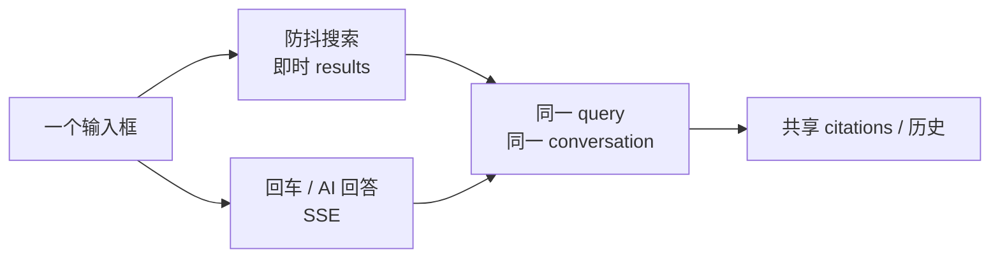

# 摘要、统一入口与会话历史（设计）

> 状态：设计基线
> 关联决策：[ADR 0009](adr/0009-summaries-and-conversations.md)
> 关联文档：[architecture.md](architecture.md)、[gap-assessment.md](gap-assessment.md)、[model-gateway-and-billing.md](model-gateway-and-billing.md)
> 范围：静态文章摘要、动态检索/问答总结、统一搜索/问答入口、KB 侧会话历史与 Zeta 映射。本文只定义契约，不写实现。

## 1. 目标与三个“动态/静态”

| 对象 | 性质 | 生成时机 | 主要用途 |
| --- | --- | --- | --- |
| 静态文章摘要 | 静态 | 转写/导入/Wiki revision 保存后异步生成 | 文章头部、搜索结果 snippet、Agent 预览 |
| 动态检索总结 | 动态 | 每次查询时 | 多轮改写、检索、证据判断、带引用回答 |
| 统一入口 | 交互 | 用户输入时 | 一个输入框同时出检索结果与 AI 回答 |

三个对象共享同一套引用与 Answer 契约，但**静态摘要不得伪装成实时回答**；动态回答必须带 citations / degraded / cache_hit。

## 2. 静态文章摘要（document/page summary）

### 2.1 触发与输入

- 触发：转写/导入完成、Wiki revision 保存后，写 `summary_jobs` 异步任务；不阻塞摄入。
- 输入：该 revision 的规范化正文；必要时带父块/全文上下文。
- 输出结构化 JSON：

| 字段 | 类型 | 说明 |
| --- | --- | --- |
| `tldr` | string | 一句话总结 |
| `bullets` | array | 3–5 条要点 |
| `keywords` | array | 关键词 |
| `entities` | array | 实体名 + 类型 |
| `lang` | string | 文档语言 |
| `source_revision` | string | 摘要依据的 revision |

### 2.2 存储

**document_summaries**

| 字段 | 类型 | 必填 | 说明 |
| --- | --- | --- | --- |
| `tenant_id` / `space_id` | string | 是 | 治理信封 |
| `doc_id` / `revision_id` | string | 是 | 摘要对应文档与 revision |
| `lang` | string | 是 | 文档语言 |
| `model` | string | 是 | 生成模型 alias/版本 |
| `prompt_version` | string | 是 | 摘要 prompt 版本 |
| `content_hash` | string | 是 | 输入正文哈希 |
| `status` | enum | 是 | `pending` / `ready` / `failed` |
| `summary_json` | json | 是 | tldr/bullets/keywords/entities/lang/source_revision |
| `usage_event_id` | string | 否 | 对应 usage_events |
| `generated_at` | timestamp | 否 | 完成时间 |
| `error` | string | 否 | 失败原因；不写敏感正文 |

唯一键：`(tenant_id, space_id, doc_id, revision_id, model, prompt_version)`。旧 revision 的摘要保留，不覆盖。

**summary_jobs**

| 字段 | 类型 | 必填 | 说明 |
| --- | --- | --- | --- |
| `job_id` | string | 是 | 主键 |
| `tenant_id` / `space_id` | string | 是 | 治理信封 |
| `doc_id` / `revision_id` | string | 是 | 目标 |
| `status` | enum | 是 | `queued` / `running` / `ready` / `failed` |
| `attempts` | integer | 是 | 重试次数 |
| `scheduled_at` / `started_at` / `finished_at` | timestamp | 是/否 | 时间 |
| `error` | string | 否 | 脱敏错误 |

### 2.3 失效与降级

| 情形 | 行为 |
| --- | --- |
| revision 变化 | 新 revision 生成新摘要；旧摘要保留 |
| 模型或 prompt_version 变化 | 重新生成；旧摘要保留用于历史 |
| content_hash 不一致 | 标记 stale，重新入队 |
| 生成失败 | `status=failed`，回退抽取式摘要（tldr/bullets 从原文选句），`degraded[]` 标 `summary_generation_failed` |
| 无 LLM / 未配置 | 直接走抽取式摘要；不阻塞摄入 |

### 2.4 展示与成本

- 文章头部展示摘要 + “基于 revision N”标识；搜索结果 snippet 可用 `tldr`，但必须标注为静态摘要。
- 静态摘要不进入实时问答的 Answer 正文；动态回答可以引用摘要作为辅助线索，但引用仍指向原文 chunk。
- 每次生成写 `usage_events`，`source=summary`；计入配额与成本；批量/限流，避免阻塞主检索。
- 默认按文档 `lang` 生成；`translated_summary` 为 P2 可选项，不默认开启。

## 3. 动态检索/问答总结

| 步骤 | 契约 |
| --- | --- |
| 多轮改写 | 取会话最近 N 轮（默认 6，可配置）作为上下文，把指代/省略改写成独立 query |
| 检索 | 复用 L3 多路通道；会话上下文只影响改写，不改变 ACL |
| 证据判断 | L4 融合/重排；Answer 带 citations、conflicts、degraded |
| 生成 | 抽取式或 LLM；SSE 流式；首 token 后持续输出 |
| 缓存 | 键含 tenant/space/alias/prompt/params/prompt_version/acl_fingerprint/index_generation/**conversation_context_hash** |
| 字段 | `summary_kind=dynamic`、`summary_source=llm / extractive`、`cache_hit` |

动态回答与静态摘要分开存储：静态在 `document_summaries`，动态在 Answer/`answer_cache`；不得把静态摘要当作“实时回答”返回。

## 4. 统一入口（搜索 + 问答）

| 项 | 契约 |
| --- | --- |
| UI | Wiki 顶部搜索栏与右侧问答面板共用状态；输入即时出检索结果（防抖），回车/点“AI 回答”在右侧流式回答 |
| 会话 | 同一 query、同一 `conversation_id`；检索结果与回答共享引用 |
| 深链 | `?q=&conversation=` 可恢复查询与对话 |
| 搜索-only | 也写入会话历史，`mode=search`；不生成 Answer |
| API | `POST /api/v1/query`，`mode=search / answer / both`（默认 `both`），返回 `results` + `answer/stream` |
| 兼容 | 保留 `GET /api/v1/search` 供程序调用；MCP `kb_query` 使用同一内核 |
| 禁止 | 不维护第二套检索/回答状态；搜索与问答不各自写一份历史 |

## 5. 会话历史

KB 是**用户可见历史的 canonical**；Zeta 是 agent working trace。

**conversations**

| 字段 | 类型 | 必填 | 说明 |
| --- | --- | --- | --- |
| `conversation_id` | string | 是 | 主键 |
| `tenant_id` / `space_id` | string | 是 | 隔离 |
| `owner_id` | string | 是 | 用户/Agent 主体 |
| `title` | string | 是 | 可自动生成/用户编辑 |
| `external_session_id` | string | 否 | Zeta session 映射 |
| `created_at` / `updated_at` | timestamp | 是 | 生命周期 |
| `status` | enum | 是 | `active` / `archived` / `deleted` |

**messages**

| 字段 | 类型 | 必填 | 说明 |
| --- | --- | --- | --- |
| `message_id` | string | 是 | 主键 |
| `conversation_id` | string | 是 | 所属会话 |
| `role` | enum | 是 | `user` / `assistant` / `system` / `tool` |
| `content` | string | 是 | 用户/助手可见正文 |
| `citations_json` | json | 是 | 引用列表 |
| `model` | string | 否 | alias |
| `usage_json` | json | 否 | token/cost/cache_hit |
| `degraded_json` | json | 否 | 降级 |
| `request_id` | string | 是 | 追踪 |
| `mode` | enum | 是 | `search` / `answer` / `both` |
| `created_at` | timestamp | 是 | 时间 |

Zeta 映射：

- `zeta_session_id ↔ conversations.external_session_id`；首链时只导入 Zeta 会话摘要，不重复存全量 trace/chain-of-thought。
- Zeta 通过 OpenAPI/MCP 调 `kb_query(conversation_id)`、`kb_get_conversation`、`kb_list_conversations`。
- KB 存用户/助手可见消息 + 引用 + usage；agent 的 chain-of-thought、工具全量 trace 留在 Zeta。
- 冲突以 KB 为展示真相，Zeta 为 agent 执行真相；对账用 `request_id` / `external_session_id`。

权限/隐私/保留：

- 按 tenant/space/owner 隔离；admin 审计可见元数据，但默认不读内容。
- 删除/保留按租户策略；删除会话写 tombstone，不物理删历史账本。
- 不得跨租户；Agent 只能访问自己 owner 或授权空间的会话。

## 6. 数据与 API 清单

| 对象 | 作用 |
| --- | --- |
| `document_summaries` | 静态文章摘要 |
| `summary_jobs` | 摘要异步任务 |
| `conversations` / `messages` | 用户可见会话历史 |
| `answer_cache` | 动态 Answer 缓存（含 conversation_context_hash） |

| 接口 | 作用 | 作用域 |
| --- | --- | --- |
| `POST /api/v1/query` | search/answer/both 统一入口 | `kb.read` |
| `GET /api/v1/search` | 程序化检索（保留） | `kb.read` |
| `POST /api/v1/answer` | 非流式回答 | `kb.read` |
| `GET /api/v1/answer/stream` | SSE 流式回答 | `kb.read` |
| `GET /api/v1/pages/{space}/{slug}/summary` | 静态摘要 | `kb.read` |
| `GET /api/v1/conversations` | 会话列表 | `kb.read` |
| `GET /api/v1/conversations/{id}` | 会话详情/消息 | `kb.read` |
| `POST /api/v1/conversations` | 新建/导入会话 | `kb.write` |
| `DELETE /api/v1/conversations/{id}` | 归档/软删除 | `kb.write` |
| MCP `kb_query` | 统一查询 | `kb.read` |
| MCP `kb_get_page_summary` | 静态摘要 | `kb.read` |
| MCP `kb_get_conversation` | 会话详情 | `kb.read` |
| MCP `kb_list_conversations` | 会话列表 | `kb.read` |

Answer 扩展字段：`conversation_id`、`message_id`、`summary_kind`（`static` / `dynamic`）、`summary_source`（`llm` / `extractive`）、`cache_hit`。

## 7. 阶段与估算

估算口径：1 人周 = 1 名熟悉 Rust/axum/sqlx 的工程师 5 个工作日；**估算，非承诺**；分项与合计独立取整，可能有 1 人周差异。

| 阶段 | 范围 | 人周 |
| --- | --- | --- |
| P0 | 静态摘要 + summary_jobs + conversations/messages + `POST /api/v1/query`（search/answer） | 5–8 |
| P1 | SSE 流式 + 多轮改写 + Zeta 会话映射 + 摘要管理页 | 4–7 |
| P2 | 语义缓存 + 翻译摘要 | 3–6 |
| **合计** |  | **12–21** |

## 8. 风险与待验证

| 风险 | 影响 | 缓解 |
| --- | --- | --- |
| 静态摘要与实时回答混淆 | 用户把旧摘要当最新答案 | UI 标注 revision/generated_at；动态回答单独字段 |
| 摘要成本 | 每 revision 生成消耗 token | 异步批处理、限流、按 space 配额、失败抽取式回退 |
| 多轮改写偏离原意 | 检索跑偏 | 保留原始 query 与改写 query 到 trace；可关闭改写 |
| 会话历史膨胀 | 存储/隐私 | 保留策略、归档、tombstone；不存 CoT |
| Zeta 双写冲突 | 两套历史不一致 | KB canonical 展示；Zeta trace 不复制；request_id 对账 |
| 统一入口缓存 | 搜索结果与回答不一致 | 同一 query/conversation/ACL/index generation 键；共享引用 |
| 删除/隐私 | 用户删除后仍可检索 | 会话 tombstone + 索引清理；审计仅元数据 |

## 9. 与现有文档的关系

- [architecture.md](architecture.md)：L2 会话上下文、L5 动态回答、L6 静态摘要 job、数据模型与 Answer 字段。
- [gap-assessment.md](gap-assessment.md)：新增“每页摘要 / 会话历史 / 统一入口”能力面与工作量修订。
- [roadmap.md](roadmap.md)：P0/P1/P2 交付与出口。
- [tier-matrix.md](tier-matrix.md)：三档摘要/会话/统一入口差异。
- [model-gateway-and-billing.md](model-gateway-and-billing.md)：摘要与动态回答的 usage/配额/模型 alias。
- [adr/0009-summaries-and-conversations.md](adr/0009-summaries-and-conversations.md)：方向决策。
